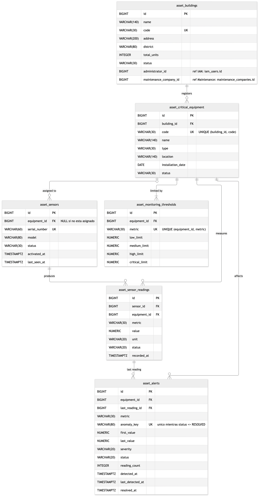
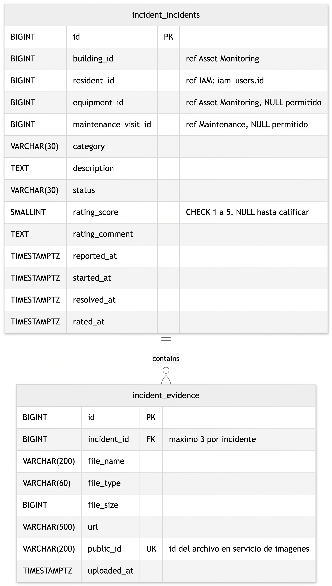
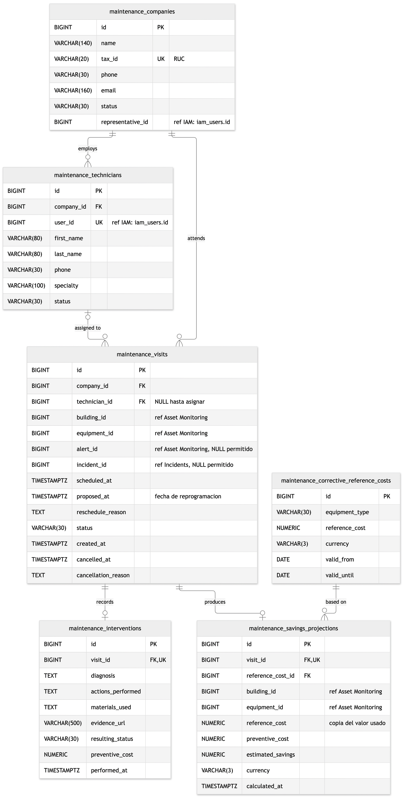
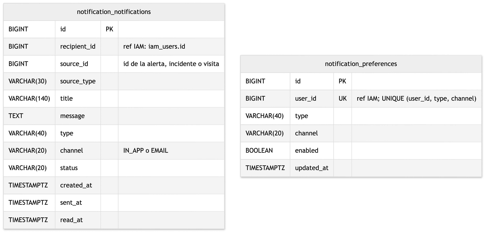
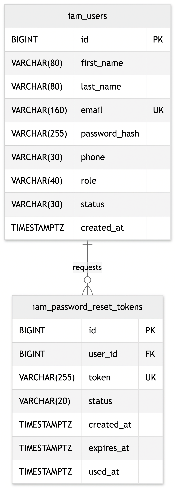

## 4.8. Database Design

MySQL guarda los cinco contextos en una sola base de datos, `vigilia`. Hibernate crea las tablas a partir de las persistence entities de la capa de infraestructura; los aggregates del dominio no tienen anotaciones JPA. La clase `SnakeCasePhysicalNamingStrategy` les da nombres en snake_case y en plural, sin prefijo de contexto: `buildings`, `incidents`, `sensor_readings`. Un aggregate referencia a otro solo por su identificador (`building_id`, `equipment_id`), sin foreign key, para que cada aggregate se guarde por separado. Los enums se guardan como VARCHAR.

### 4.8.1. Database Diagrams

#### 4.8.1.1. Asset Monitoring

`sensors.device_id` admite NULL, porque un sensor puede estar sin asignar. Una sola columna de dispositivo hace que el sensor pertenezca a un dispositivo a la vez. En el Sprint 3 la tabla `critical_equipment` pasó a llamarse `devices` y las columnas `equipment_id` pasaron a `device_id`; el diagrama todavía muestra los nombres anteriores.

| Tabla | Constraint | Motivo |
  |---|---|---|
| devices | UNIQUE (building_id, code) | Código único por edificio |
| monitoring_thresholds | UNIQUE (device_id, metric) | Un umbral por métrica |
| alerts | Validación en la aplicación: una sola alerta no resuelta por dispositivo y métrica | MySQL no admite índices únicos parciales |

#### 4.8.1.2. Incidents

`incident_evidences.public_id` es único porque identifica el archivo en el sistema de almacenamiento de imágenes. El límite de tres evidencias se valida en el agregado Incident. La calificación es una columna del incidente con CHECK de 1 a 5.

#### 4.8.1.3. Maintenance

`visit_id` es UNIQUE en intervenciones y en proyecciones de ahorro: cada visita tiene como máximo una de cada una. `maintenance_savings_projections.reference_cost` copia el valor usado, así el historial no cambia si se actualiza el catálogo.

#### 4.8.1.4. Notifications

Cada fila de `notification_notifications` es un aviso para un destinatario y un canal. `notification_preferences` tiene UNIQUE (user_id, type, channel).

#### 4.8.1.5. IAM

`iam_users.email` y `iam_password_reset_tokens.token` son UNIQUE. Así se evitan cuentas duplicadas y tokens reutilizados.

