### 5.2.3. Sprint 3

En el Sprint 3 construimos la primera versión del RESTful API de Vigilia con Spring Boot y MySQL, y conectamos la Web Application a ese API en lugar del fake API. Seguimos el orden del Product Backlog: primero los bounded contexts core, Asset Monitoring e Incidents. IAM queda para el Sprint 4. También publicamos una nueva versión del Landing Page y validamos el producto con entrevistas a los tres segmentos.

#### 5.2.3.1. Sprint Planning 3

Antes de planificar revisamos el resultado del Sprint 2 y la retroalimentación de TB1. El equipo pasó de cuatro a tres integrantes: Salazar Miranda, Mateo Paolo se retiró del curso el 1/11/2026, y sus tareas las asumió el Team Leader.

| Sprint # | Sprint 3 |
|:---|:---|
| **Sprint Planning Background** | |
| Date | 2026-10-28 |
| Time | 07:30 PM |
| Location | Reunión virtual en Google Meet |
| Prepared By | Valladolid Jiménez, Arturo Fernando |
| Attendees (to planning meeting) | Valladolid Jiménez, Arturo Fernando / Diaz Vargas, Fernanda Ysabella / Romero Veliz, Matthias Alonso |
| Sprint 2 Review Summary | Publicamos en Vercel la primera versión de la Web Application, con edificios, equipos críticos, sensores, historial de lecturas, alertas e incidentes sobre un fake API, y una nueva versión del Landing Page en GitHub Pages. Quedaron terminadas US07, US08, US09, US10, US11, US14, US19, US20, US23, US25 y US27. En la revisión de TB1 el profesor observó cuatro puntos: al Landing Page le faltaban la sección About the Team y los términos y condiciones; la Web Application no tenía un release con tag, quedaban ramas `feature` abiertas y `develop` iba detrás de `main`; casi todo el código se hizo en los últimos días y solo dos integrantes tenían commits de producto; y nos pidió empezar antes, porque el sprint dura cuatro semanas. En este sprint cada repositorio sale con un release y su tag, borramos las ramas después del merge y los tres integrantes tienen commits de producto en el RESTful API. El Landing Page ya tiene términos y condiciones y la sección About the Team. |
| Sprint 2 Retrospective Summary | Lo que salió bien: GitFlow y Pull Requests en todos los repositorios, y un orden de merge acordado que evitó conflictos. Lo que debemos mejorar: repartir mejor el trabajo entre los repositorios y hacer commits en más días del sprint. Acordamos que cada integrante tenga commits en todos los repositorios y que cada Pull Request lo revise otro integrante. |
| **Sprint Goal & User Stories** | |
| Sprint 3 Goal | Nuestro objetivo es lanzar la primera versión de la API RESTful de Vigilia y conectar la aplicación web a ella. Creemos que ofrece una persistencia real de los datos sobre edificios, equipos, sensores, lecturas, alertas e incidentes a los administradores, residentes y empresas de mantenimiento. Esto se confirmará cuando los usuarios, durante las entrevistas de validación, completen sus tareas en la aplicación web implementada y respaldada por la API.|
| Sprint 3 Velocity | 41 story points |
| Sum of Story Points | 41 (US48: 2, US49: 2, US07: 2, US08: 3, US09: 3, US10: 3, US11: 2, US12: 8, US14: 3, US19: 3, US20: 2, US23: 3, US25: 3, US27: 2) |

Además de estas user stories, el sprint incluye las Technical Stories TS01 a TS24 (sección 3.1), que describen los endpoints del RESTful API.

#### 5.2.3.2. Aspect Leaders and Collaborators

Dividimos el sprint en nueve aspectos. Cuatro son partes del RESTful API y siguen los bounded contexts; los demás son la integración de la Web Application, el Landing Page, las entrevistas de validación, los videos y el informe. Cada líder trabaja su aspecto en su propia rama `feature`, y otro integrante revisa el Pull Request antes del merge.

| Team Member (Last Name, First Name) | GitHub Username | Buildings y despliegue | Devices | Sensors and Readings | Incidents and Alerts | Frontend integration | Landing Page | Validation interviews | Videos | Report |
|:---|:---|:---:|:---:|:---:|:---:|:---:|:---:|:---:|:---:|:---:|
| Valladolid Jiménez, Arturo Fernando | artuvall | L | C | C | L | L | L | C | L | L |
| Diaz Vargas, Fernanda Ysabella | Fern9901 | C | L | C | C | C | C | C | C | C |
| Romero Veliz, Matthias Alonso | AlonsoVelizUpc | C | C | L | C | C | C | L | C | C |

#### 5.2.3.3. Sprint Backlog 3

El objetivo del sprint es tener la primera versión del RESTful API y conectar la Web Application a ella. Dividimos cada historia en tareas por capa (domain, application, infrastructure e interfaces) y por repositorio. Las tareas sin historia son de configuración, despliegue, validación o videos. La tabla muestra el estado al cierre del sprint. Las tareas T30 a T37 se agregaron durante el sprint: salen del pedido del profesor de usar el término *device* y de lo que encontramos en las entrevistas de validación.

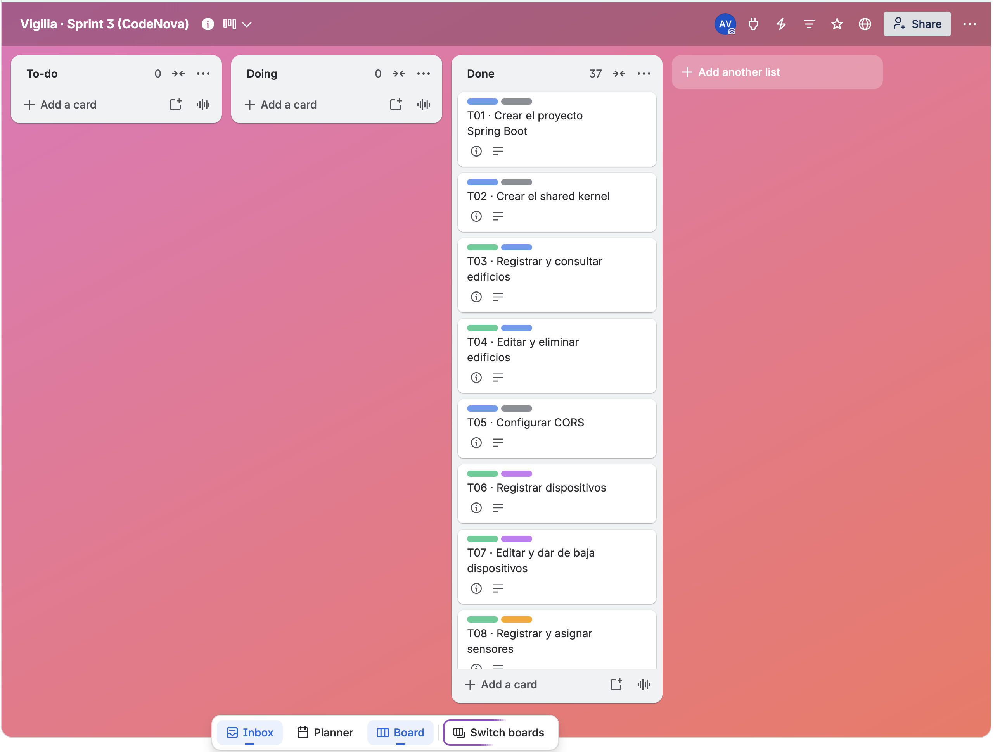

URL del tablero: <https://trello.com/b/Gnvv5wFX>

| Sprint # | Sprint 3 | | | | | | |
|:---|:---|:---|:---|:---|:---|:---|:---|
| **User Story** | | **Work-Item / Task** | | | | | |
| Story Id | Story Title | Task Id | Task Title | Task Description | Estimation (Hours) | Assigned To | Status |
| — | Configuración transversal | T01 | Crear el proyecto Spring Boot | Proyecto base con Spring Web, Spring Data JPA, Validation, MySQL, SpringDoc y Lombok. | 3 | Valladolid Jiménez, Arturo Fernando | Done |
| — | Configuración transversal | T02 | Crear el shared kernel | `SnakeCasePhysicalNamingStrategy`, `Result`, `GlobalExceptionHandler` y mensajes en inglés y español. | 3 | Valladolid Jiménez, Arturo Fernando | Done |
| US07 | Registro de un edificio y sus datos generales | T03 | Registrar y consultar edificios | Aggregate `Building` con el comando `RegisterBuilding` (POST), GET y GET por id. | 5 | Valladolid Jiménez, Arturo Fernando | Done |
| US07 | Registro de un edificio y sus datos generales | T04 | Editar y eliminar edificios | PUT y DELETE con `Result` y respuestas 200, 204 y 404. | 3 | Valladolid Jiménez, Arturo Fernando | Done |
| — | Configuración transversal | T05 | Configurar CORS | Permitir las llamadas desde `localhost:4200` y desde Vercel. | 1 | Valladolid Jiménez, Arturo Fernando | Done |
| US08 | Registro de equipos críticos del edificio | T06 | Registrar dispositivos | Aggregate `Device` (antes `CriticalEquipment`) con POST, GET con filtro `buildingId` y GET por id. | 5 | Diaz Vargas, Fernanda Ysabella | Done |
| US09 | Edición o baja de un equipo registrado | T07 | Editar y dar de baja dispositivos | PUT con la regla de que un dispositivo dado de baja no cambia. | 3 | Diaz Vargas, Fernanda Ysabella | Done |
| US10 | Asociación de sensores a un equipo específico | T08 | Registrar y asignar sensores | Aggregate `Sensor` con asignación a un dispositivo activo. | 5 | Romero Veliz, Matthias Alonso | Done |
| US12 | Recepción y registro de lecturas de sensores | T09 | Registrar lecturas | Aggregate `SensorReading` con `MetricType` y POST de lecturas. | 4 | Romero Veliz, Matthias Alonso | Done |
| US14 | Consulta del historial de lecturas de un equipo | T10 | Historial de lecturas | GET de lecturas por dispositivo, ordenadas de la más reciente a la más antigua. | 3 | Romero Veliz, Matthias Alonso | Done |
| US23 | Reporte de incidente por parte del residente | T11 | Reportar incidentes | Bounded context Incidents: aggregate `Incident`, POST y GET con filtro `buildingId`. | 5 | Valladolid Jiménez, Arturo Fernando | Done |
| US25 | Seguimiento del estado de un incidente reportado | T12 | Cambiar el estado de un incidente | `StartIncidentManagement` y `ResolveIncident` como sub-recursos POST (`management-starts`, `resolutions`), con las transiciones REPORTED → IN_PROGRESS → RESOLVED. | 3 | Valladolid Jiménez, Arturo Fernando | Done |
| US27 | Calificación del incidente resuelto | T13 | Calificar un incidente | `RateIncident` como sub-recurso POST (`ratings`): calificación de 1 a 5, solo para incidentes resueltos y sin calificar. | 2 | Valladolid Jiménez, Arturo Fernando | Done |
| US19 | Visualización de alertas activas en el dashboard | T14 | Registrar y listar alertas | Aggregate `Alert` con POST y GET con filtro `status`. | 4 | Valladolid Jiménez, Arturo Fernando | Done |
| US20 | Cambio de estado de una alerta | T15 | Cambiar el estado de una alerta | Comandos `AcknowledgeAlert` y `ResolveAlert` como sub-recursos `acknowledgements` y `resolutions`. | 2 | Valladolid Jiménez, Arturo Fernando | Done |
| — | Despliegue | T16 | Perfiles y Dockerfile | Perfiles `dev` y `prod` e imagen Docker del RESTful API. | 2 | Valladolid Jiménez, Arturo Fernando | Done |
| — | Despliegue | T17 | Desplegar el RESTful API | Base de datos MySQL en la nube, Web Service en Render y carga de datos de demo. | 4 | Valladolid Jiménez, Arturo Fernando | Done |
| — | Integración | T18 | Conectar la Web Application al API | Environments de desarrollo y producción, y mensajes de error del API en los formularios. | 2 | Valladolid Jiménez, Arturo Fernando | Done |
| US08 | Registro de equipos críticos del edificio | T19 | Verificar dispositivos con el API | Probar listas, formularios y baja de dispositivos con el API real y validar el código antes de enviarlo. | 2 | Diaz Vargas, Fernanda Ysabella | Done |
| US14 | Consulta del historial de lecturas de un equipo | T20 | Verificar sensores y lecturas con el API | Asignar y liberar sensores con POST a `assignments` y `releases`, y probar el historial con el API real. | 2 | Romero Veliz, Matthias Alonso | Done |
| US23 | Reporte de incidente por parte del residente | T21 | Verificar incidentes y alertas con el API | Probar reporte, cambio de estado y calificación de incidentes, y el cambio de estado de alertas. Agregar accesos por rol en Home. | 4 | Valladolid Jiménez, Arturo Fernando | Done |
| US48 | Visualización de la landing page informativa | T22 | Sección About the Product | Video About-the-Product incrustado en el Landing Page. | 2 | Diaz Vargas, Fernanda Ysabella | In Progress |
| US48 | Visualización de la landing page informativa | T23 | Sección About the Team | Video About-the-Team incrustado en el Landing Page. | 2 | Diaz Vargas, Fernanda Ysabella | In Progress |
| US48 | Visualización de la landing page informativa | T24 | Call-to-action por segmento | Una tarjeta por segmento con un botón a su vista en la Web Application. | 2 | Valladolid Jiménez, Arturo Fernando | Done |
| US49 | Solicitud de demo desde la landing page | T25 | Meta tags y Open Graph | Título, descripción y etiquetas Open Graph alineados con la sección 4.2.3. | 1 | Valladolid Jiménez, Arturo Fernando | Done |
| — | Validación | T26 | Entrevistas de validación | Entrevistas por segmento sobre la Web Application desplegada. | 6 | Valladolid Jiménez, Arturo Fernando / Diaz Vargas, Fernanda Ysabella / Romero Veliz, Matthias Alonso | Done |
| — | Validación | T27 | Evaluación heurística | Problemas de usabilidad encontrados en las entrevistas, con su severidad y recomendación. | 3 | Valladolid Jiménez, Arturo Fernando | Done |
| — | Documentación | T28 | Technical Stories | Technical Stories de los endpoints del RESTful API con criterios en Gherkin. | 3 | Diaz Vargas, Fernanda Ysabella | Done |
| — | Videos | T29 | Edición de videos | Entrevistas de validación, About-the-Product, navegación del producto y About-the-Team. | 8 | Valladolid Jiménez, Arturo Fernando | In Progress |
| — | Lenguaje ubicuo | T30 | Renombrar Equipment a Device en el RESTful API | Aggregate, comandos, persistencia (tabla `devices`), endpoint `/api/v1/devices` y `deviceId` en sensores, lecturas, alertas e incidentes. | 6 | Diaz Vargas, Fernanda Ysabella / Romero Veliz, Matthias Alonso | Done |
| — | Lenguaje ubicuo | T31 | Renombrar Equipment a Device en la Web Application | Entidad, store, vistas, ruta `/asset-monitoring/devices` y textos "Devices" y "Dispositivos". | 4 | Diaz Vargas, Fernanda Ysabella / Romero Veliz, Matthias Alonso | Done |
| US19 | Visualización de alertas activas en el dashboard | T32 | Valor límite y orden de las alertas | `thresholdValue` en cada alerta, desempate entre alertas de la misma severidad según cuánto superan su límite, y botón "Atender". | 4 | Diaz Vargas, Fernanda Ysabella | Done |
| US11 | Consulta del listado de equipos por edificio | T33 | Alertas activas por dispositivo | Número de alertas activas de cada dispositivo en su lista, con enlace al tablero de alertas. | 2 | Diaz Vargas, Fernanda Ysabella | Done |
| US14 | Consulta del historial de lecturas de un equipo | T34 | Métricas de corriente y presión | Métricas `CURRENT` y `PRESSURE` en el RESTful API y en la Web Application. | 2 | Romero Veliz, Matthias Alonso | Done |
| US19 | Visualización de alertas activas en el dashboard | T35 | Filtros y confirmaciones | Filtros de alertas por edificio y tipo de dispositivo, edificio y filtro en incidentes, y confirmación antes de resolver o eliminar. | 4 | Romero Veliz, Matthias Alonso | Done |
| US48 | Visualización de la landing page informativa | T36 | Privacidad y libro de reclamaciones | Términos y política de privacidad en el Landing Page y en la Web Application, libro de reclamaciones y sección por segmento debajo del hero. | 4 | Diaz Vargas, Fernanda Ysabella / Romero Veliz, Matthias Alonso | Done |
| — | Despliegue | T37 | Releases finales del sprint | Releases `0.3.0` y `2.0.0` del RESTful API, `2.0.0` de la Web Application y `0.3.2` del Landing Page, con el reinicio de la base de datos de producción. | 3 | Romero Veliz, Matthias Alonso / Valladolid Jiménez, Arturo Fernando | Done |

#### 5.2.3.4. Development Evidence for Sprint Review

En este sprint creamos el repositorio del RESTful API y seguimos con GitFlow en los cuatro repositorios. A pedido del profesor los renombramos durante el sprint: `backend` pasó a `Web-services`, `Frontend` a `Web-App` y `landing-page` a `Website`; la tabla usa los nombres nuevos. Cada aspecto se trabajó en una rama `feature` (o `fix` y `docs`) creada desde `develop` y entró con un Pull Request. Cada versión salió a `main` con una rama `release` y su tag: Web-services con `0.1.0`, `0.2.0`, `0.3.0` y `2.0.0`; Web-App con `0.2.0`, `0.3.0` y `2.0.0`; y Website con `0.2.0`, `0.3.0`, `0.3.1` y `0.3.2`. La tabla muestra los commits del sprint desde el 28/10/2026, sin los merges.

| Repository | Branch | Commit Id | Commit Message | Commit Message Body | Committed on (Date) |
|:---|:---|:---|:---|:---|:---|
| code-nova-1asi0729/Web-services | develop | d3bbb43 | "chore: initial commit" | — | 28/10/2026 |
| code-nova-1asi0729/Web-services | feature/project-configuration | a74471e | docs: add README | — | 29/10/2026 |
| code-nova-1asi0729/Web-services | feature/project-configuration | 37ea536 | build: update project dependencies | — | 29/10/2026 |
| code-nova-1asi0729/Web-services | feature/project-documentation | 5ff55be | docs: update readme and pom.xml file | — | 30/10/2026 |
| code-nova-1asi0729/Web-services | feature/project-documentation | 1f6c9a4 | docs: add project-level documentation files | — | 30/10/2026 |
| code-nova-1asi0729/Web-services | feature/shared | af7869f | build: configure MySQL datasource and JPA auditing | — | 30/10/2026 |
| code-nova-1asi0729/Web-services | feature/shared | 4438740 | feat(naming-strategy): add snake case and plural table naming strategy | — | 30/10/2026 |
| code-nova-1asi0729/Web-services | feature/shared | 08b18af | feat(result): add abstraction for result pattern implementation | — | 30/10/2026 |
| code-nova-1asi0729/Web-services | feature/shared | a6a328a | feat(error-handling): add global exception handler with localized messages | — | 30/10/2026 |
| code-nova-1asi0729/Web-services | feature/asset-monitoring-buildings | b358473 | feat(buildings): add building value objects | — | 30/10/2026 |
| code-nova-1asi0729/Web-services | feature/asset-monitoring-buildings | 0432082 | feat(buildings): add create building command | — | 30/10/2026 |
| code-nova-1asi0729/Web-services | feature/asset-monitoring-buildings | c48c1ce | feat(buildings): add attribute converter for BuildingCode | — | 30/10/2026 |
| code-nova-1asi0729/Web-services | feature/asset-monitoring-buildings | 3527d7a | feat(buildings): add building aggregate root | — | 30/10/2026 |
| code-nova-1asi0729/Web-services | feature/asset-monitoring-buildings | b3feece | feat(buildings): add building queries | — | 30/10/2026 |
| code-nova-1asi0729/Web-services | feature/asset-monitoring-buildings | 00f0c89 | feat(buildings): add building outbound service | — | 30/10/2026 |
| code-nova-1asi0729/Web-services | feature/asset-monitoring-buildings | 5b1ac16 | feat(buildings): add building command service contract and failure types | — | 30/10/2026 |
| code-nova-1asi0729/Web-services | feature/asset-monitoring-buildings | 7d01456 | feat(buildings): add building command service implementation | — | 30/10/2026 |
| code-nova-1asi0729/Web-services | feature/asset-monitoring-buildings | 085f9ed | feat(buildings): add building query service | — | 30/10/2026 |
| code-nova-1asi0729/Web-services | feature/asset-monitoring-buildings | edbca43 | feat(buildings): add REST resources to interface layer | — | 30/10/2026 |
| code-nova-1asi0729/Web-services | feature/asset-monitoring-buildings | 24da531 | feat(buildings): add resource and command assemblers | — | 30/10/2026 |
| code-nova-1asi0729/Web-services | feature/asset-monitoring-buildings | b602664 | feat(buildings): add response entity assemblers | — | 30/10/2026 |
| code-nova-1asi0729/Web-services | feature/asset-monitoring-buildings | f816e85 | feat(buildings): add buildings inbound service | — | 30/10/2026 |
| code-nova-1asi0729/Web-services | feature/team-update | 07af056 | docs: remove withdrawn member from readme and pom | — | 01/11/2026 |
| code-nova-1asi0729/Website | feature/landing-team-update | ef415c1 | feat(landing): update team section to three members | — | 01/11/2026 |
| code-nova-1asi0729/project-report | feature/report-technical-stories | 2f8e04a | docs(report): remove withdrawn member from cover and team profiles | — | 01/11/2026 |
| code-nova-1asi0729/project-report | feature/report-technical-stories | 75c5b9d | docs(report): log team change | — | 01/11/2026 |
| code-nova-1asi0729/project-report | feature/report-technical-stories | a74fe16 | docs(report): add sprint 3 structure and planning | — | 01/11/2026 |
| code-nova-1asi0729/Web-services | feature/asset-monitoring-buildings-update | 9ec2faa | feat(asset-monitoring): add metric type value object | — | 02/11/2026 |
| code-nova-1asi0729/Web-services | feature/asset-monitoring-buildings-update | 9ccc7a1 | feat(buildings): add update and delete building commands | — | 02/11/2026 |
| code-nova-1asi0729/Web-services | feature/asset-monitoring-buildings-update | b9c5457 | feat(buildings): handle building update and delete | — | 02/11/2026 |
| code-nova-1asi0729/Web-services | feature/asset-monitoring-buildings-update | 2002882 | refactor(buildings): pass success status to command result assembler | — | 03/11/2026 |
| code-nova-1asi0729/Web-services | feature/asset-monitoring-buildings-update | d3881f8 | feat(buildings): add update and delete building endpoints | — | 03/11/2026 |
| code-nova-1asi0729/Web-services | feature/shared-cors | 756759a | feat(shared): add cors configuration for web application | — | 03/11/2026 |
| code-nova-1asi0729/Web-services | feature/shared-cors | 47fd0c7 | test(buildings): add http requests for buildings endpoints | — | 03/11/2026 |
| code-nova-1asi0729/Web-services | feature/incidents | 393f119 | feat(incidents): add incident value objects | — | 03/11/2026 |
| code-nova-1asi0729/Web-services | feature/incidents | 7744dcf | feat(incidents): add incident commands | — | 03/11/2026 |
| code-nova-1asi0729/Web-services | feature/incidents | 826420a | feat(incidents): add attribute converter for RatingScore | — | 03/11/2026 |
| code-nova-1asi0729/Web-services | feature/incidents | 103587d | feat(incidents): add incident aggregate root | — | 03/11/2026 |
| code-nova-1asi0729/Web-services | feature/incidents | 5942e23 | feat(incidents): add incident queries | — | 03/11/2026 |
| code-nova-1asi0729/Web-services | feature/incidents | 69f8365 | feat(incidents): add incident outbound service | — | 03/11/2026 |
| code-nova-1asi0729/Web-services | feature/incidents | b0093ef | feat(incidents): add incident command service contract and failure types | — | 03/11/2026 |
| code-nova-1asi0729/Web-services | feature/incidents | 31137a1 | feat(incidents): add incident command service implementation | — | 03/11/2026 |
| code-nova-1asi0729/Web-services | feature/incidents | 59ce495 | feat(incidents): add incident query service | — | 03/11/2026 |
| code-nova-1asi0729/project-report | feature/report-technical-stories | b726094 | docs(report): align architecture and database design with mysql | — | 03/11/2026 |
| code-nova-1asi0729/project-report | feature/report-technical-stories | 17a0ffc | docs(report): add sprint 3 backlog | — | 03/11/2026 |
| code-nova-1asi0729/Web-services | feature/incidents | 62336e8 | feat(incidents): add REST resources to interface layer | — | 05/11/2026 |
| code-nova-1asi0729/Web-services | feature/incidents | 664dafb | feat(incidents): add resource and command assemblers | — | 05/11/2026 |
| code-nova-1asi0729/Web-services | feature/incidents | 0048e35 | feat(incidents): add response entity assemblers | — | 05/11/2026 |
| code-nova-1asi0729/Web-services | feature/incidents | b1286a2 | feat(incidents): add incidents inbound service | — | 05/11/2026 |
| code-nova-1asi0729/Web-services | feature/incidents | 0d18f64 | test(incidents): add incident unit tests and http requests | — | 05/11/2026 |
| code-nova-1asi0729/Web-services | feature/asset-monitoring-equipment | b0e8ddc | feat(equipment): add equipment value objects | — | 05/11/2026 |
| code-nova-1asi0729/Web-services | feature/asset-monitoring-equipment | f8714b3 | feat(equipment): add equipment value objects | — | 05/11/2026 |
| code-nova-1asi0729/Web-services | feature/asset-monitoring-equipment | 6a20ab9 | feat(equipment): add equipment commands | — | 05/11/2026 |
| code-nova-1asi0729/Web-services | feature/asset-monitoring-equipment | 501bf62 | feat(equipment): add attribute converter for EquipmentCode | — | 05/11/2026 |
| code-nova-1asi0729/Web-services | feature/asset-monitoring-equipment | 35e9555 | feat(equipment): add critical equipment aggregate root | — | 05/11/2026 |
| code-nova-1asi0729/Web-services | feature/asset-monitoring-equipment | aab1e4e | feat(equipment): add equipment queries | — | 05/11/2026 |
| code-nova-1asi0729/Web-services | feature/asset-monitoring-equipment | 27cc8c2 | feat(equipment): add equipment outbound service | — | 05/11/2026 |
| code-nova-1asi0729/Web-services | feature/asset-monitoring-equipment | 07f11ca | feat(equipment): add equipment command service contract and failure types | — | 05/11/2026 |
| code-nova-1asi0729/Web-services | feature/asset-monitoring-equipment | 873e41a | feat(equipment): add equipment command service implementation | — | 05/11/2026 |
| code-nova-1asi0729/Web-services | feature/asset-monitoring-equipment | 5815932 | feat(equipment): add equipment query service | — | 05/11/2026 |
| code-nova-1asi0729/Web-services | feature/asset-monitoring-equipment | 056a14e | feat(equipment): add REST resources to interface layer | — | 05/11/2026 |
| code-nova-1asi0729/Web-services | feature/persistence-adapters | aa7affd | refactor(shared): add domain aggregate root and auditable persistence entity | — | 06/11/2026 |
| code-nova-1asi0729/Web-services | feature/persistence-adapters | 3278f29 | refactor(buildings): add building domain repository contract | — | 06/11/2026 |
| code-nova-1asi0729/Web-services | feature/persistence-adapters | 2dfdce3 | refactor(buildings): add building persistence entity, repository and assembler | — | 06/11/2026 |
| code-nova-1asi0729/Web-services | feature/persistence-adapters | ca025b7 | refactor(buildings): decouple building aggregate from jpa through repository adapter | — | 06/11/2026 |
| code-nova-1asi0729/Web-services | feature/persistence-adapters | 1467bef | refactor(incidents): add incident domain repository contract | — | 06/11/2026 |
| code-nova-1asi0729/Web-services | feature/persistence-adapters | ea03110 | refactor(incidents): add incident persistence entity, repository and assembler | — | 06/11/2026 |
| code-nova-1asi0729/Web-services | feature/persistence-adapters | 92011d0 | refactor(incidents): decouple incident aggregate from jpa through repository adapter | — | 06/11/2026 |
| code-nova-1asi0729/Web-services | feature/asset-monitoring-equipment | adc90fc | feat(equipment): add equipment messages | — | 06/11/2026 |
| code-nova-1asi0729/Web-services | feature/asset-monitoring-equipment | d7cd71e | feat(equipment): add resource and command assemblers | — | 06/11/2026 |
| code-nova-1asi0729/Web-services | feature/asset-monitoring-equipment | 1191ba9 | feat(equipment): add response entity assemblers | — | 06/11/2026 |
| code-nova-1asi0729/Web-services | feature/asset-monitoring-equipment | 1c707fa | feat(equipment): add equipment inbound service | — | 06/11/2026 |
| code-nova-1asi0729/Web-services | feature/asset-monitoring-equipment | 4362d23 | refactor(equipment): rename commands with domain verbs | — | 06/11/2026 |
| code-nova-1asi0729/Web-services | feature/asset-monitoring-equipment | d7bc623 | test(equipment): add equipment unit tests and http requests | — | 06/11/2026 |
| code-nova-1asi0729/Web-services | feature/fix-equipment-build | 3ec2d28 | fix(equipment): use building domain repository to check the building | — | 06/11/2026 |
| code-nova-1asi0729/Web-services | feature/fix-equipment-build | 0cc4759 | docs(incidents): restore incident command failure description | — | 06/11/2026 |
| code-nova-1asi0729/Web-services | feature/buildings-ubiquitous-language | 5bc5114 | refactor(buildings): rename create building to register building | — | 06/11/2026 |
| code-nova-1asi0729/Web-services | feature/asset-monitoring-alerts | 721ed20 | feat(alerts): add alert value objects | — | 06/11/2026 |
| code-nova-1asi0729/Web-services | feature/asset-monitoring-alerts | fc1a3c2 | feat(alerts): add alert commands | — | 06/11/2026 |
| code-nova-1asi0729/Web-services | feature/asset-monitoring-alerts | 5c515c7 | feat(alerts): add alert aggregate root | — | 06/11/2026 |
| code-nova-1asi0729/Web-services | feature/asset-monitoring-alerts | 5228cd4 | feat(alerts): add alert queries | — | 06/11/2026 |
| code-nova-1asi0729/Web-services | feature/asset-monitoring-alerts | 41fac17 | feat(alerts): add alert domain repository contract | — | 06/11/2026 |
| code-nova-1asi0729/Web-services | feature/asset-monitoring-alerts | 9631256 | feat(alerts): add alert persistence entity, repository and assembler | — | 06/11/2026 |
| code-nova-1asi0729/Web-services | feature/asset-monitoring-alerts | 5f51a49 | feat(alerts): add alert repository adapter | — | 06/11/2026 |
| code-nova-1asi0729/Web-services | feature/asset-monitoring-alerts | 77a75e9 | feat(alerts): add alert command service contract and failure types | — | 06/11/2026 |
| code-nova-1asi0729/Web-services | feature/asset-monitoring-alerts | 3dce94b | feat(alerts): add alert command service implementation | — | 06/11/2026 |
| code-nova-1asi0729/Web-services | feature/asset-monitoring-alerts | 9554cd6 | feat(alerts): add alert query service | — | 06/11/2026 |
| code-nova-1asi0729/Web-services | feature/asset-monitoring-alerts | 4c4eb8c | feat(alerts): add REST resources to interface layer | — | 06/11/2026 |
| code-nova-1asi0729/Web-services | feature/asset-monitoring-alerts | b74a3df | feat(alerts): add resource and command assemblers | — | 06/11/2026 |
| code-nova-1asi0729/Web-services | feature/asset-monitoring-alerts | eabe447 | feat(alerts): add response entity assemblers | — | 06/11/2026 |
| code-nova-1asi0729/Web-services | feature/asset-monitoring-alerts | b5a27b6 | feat(alerts): add alerts inbound service | — | 06/11/2026 |
| code-nova-1asi0729/Web-services | feature/asset-monitoring-alerts | 9dfff8a | test(alerts): add alert unit tests and http requests | — | 06/11/2026 |
| code-nova-1asi0729/Web-services | feature/asset-monitoring-alerts | 511d96a | fix(alerts): rename last value column to avoid mysql reserved word | — | 06/11/2026 |
| code-nova-1asi0729/Web-services | feature/deployment-configuration | 7cd4e66 | build(config): add dev and prod profiles | — | 06/11/2026 |
| code-nova-1asi0729/Web-services | feature/deployment-configuration | b57ce5f | build(container): add dockerfile | — | 06/11/2026 |
| code-nova-1asi0729/project-report | feature/report-technical-stories | 59d1fe9 | docs(report): add technical stories for buildings and equipment endpoints | — | 06/11/2026 |
| code-nova-1asi0729/project-report | feature/report-technical-stories | 357f6c0 | docs(report): add technical stories for sensors, readings, alerts and incidents endpoints | — | 06/11/2026 |
| code-nova-1asi0729/project-report | feature/report-technical-stories | 0a6c641 | docs(report): add technical stories to product backlog | — | 06/11/2026 |
| code-nova-1asi0729/Web-App | feature/real-api-configuration | a099e0f | feat(shared): point development environment to local api | — | 07/11/2026 |
| code-nova-1asi0729/Web-App | feature/real-api-configuration | 7d01278 | feat(shared): show api problem detail in error messages | — | 07/11/2026 |
| code-nova-1asi0729/Web-App | feature/real-api-configuration | 34cb34e | feat(asset-monitoring): use alert acknowledgement and resolution endpoints | — | 07/11/2026 |
| code-nova-1asi0729/Web-services | feature/equipment-persistence-adapters | b3cfd18 | refactor(equipment): add equipment domain repository contract | — | 07/11/2026 |
| code-nova-1asi0729/Web-services | feature/equipment-persistence-adapters | 9fe980e | refactor(equipment): add equipment persistence entity, repository and assembler | — | 07/11/2026 |
| code-nova-1asi0729/Web-services | feature/equipment-persistence-adapters | 3545614 | refactor(equipment): decouple critical equipment aggregate from jpa through repository adapter | — | 07/11/2026 |
| code-nova-1asi0729/Web-services | feature/equipment-persistence-adapters | 57788b5 | refactor(equipment): align equipment api wording with register command | — | 07/11/2026 |
| code-nova-1asi0729/Web-services | feature/contributing-conventions | e016f47 | docs: add code conventions to contributing guide | — | 07/11/2026 |
| code-nova-1asi0729/Web-services | release/0.1.0 | 6204d22 | build: set project version to 0.1.0 | — | 07/11/2026 |
| code-nova-1asi0729/Web-services | release/0.1.0 | b0749ba | docs: update changelog for release 0.1.0 | — | 07/11/2026 |
| code-nova-1asi0729/Web-services | feature/demo-data-environments | cc97bf8 | test(shared): add http client environments for dev and prod | — | 07/11/2026 |
| code-nova-1asi0729/Web-services | feature/demo-data-environments | 4a21bdd | test(shared): add demo data requests for the deployed api | — | 07/11/2026 |
| code-nova-1asi0729/Web-App | feature/production-api | a109d9c | feat(shared): point production environment to deployed api | — | 07/11/2026 |
| code-nova-1asi0729/Web-App | release/0.2.0 | 74ae7b5 | build: set project version to 0.2.0 | — | 07/11/2026 |
| code-nova-1asi0729/Web-App | release/0.2.0 | 2947179 | docs: add changelog for release 0.2.0 | — | 07/11/2026 |
| code-nova-1asi0729/project-report | feature/report-sprint3-owners | ee7a580 | docs(report): fix sprint 3 owners and align tasks with domain commands | — | 07/11/2026 |
| code-nova-1asi0729/project-report | feature/report-sprint3-owners | 09da32f | docs(report): align alert technical stories with domain commands | — | 07/11/2026 |
| code-nova-1asi0729/project-report | feature/report-deployment-evidence | a9eada9 | docs(report): update deployment configuration for restful api | — | 07/11/2026 |
| code-nova-1asi0729/project-report | feature/report-deployment-evidence | abeaf8a | docs(report): add deployment evidence for sprint 3 | — | 07/11/2026 |
| code-nova-1asi0729/project-report | feature/report-deployment-evidence | 3194cc8 | docs(report): update sprint 3 deployment task status | — | 07/11/2026 |
| code-nova-1asi0729/project-report | feature/report-deployment-evidence | 50c9666 | docs(report): add sprint 3 deployment screenshots | — | 07/11/2026 |
| code-nova-1asi0729/Web-services | feature/asset-monitoring-sensors | 4f777a6 | feat(sensors): add serial number and sensor status value objects | — | 08/11/2026 |
| code-nova-1asi0729/Web-services | feature/asset-monitoring-sensors | 434e819 | feat(sensors): add sensor commands | — | 08/11/2026 |
| code-nova-1asi0729/Web-services | feature/asset-monitoring-sensors | c6c4694 | feat(sensors): add sensor aggregate | — | 08/11/2026 |
| code-nova-1asi0729/Web-services | feature/asset-monitoring-sensors | 7860ad1 | feat(sensors): add sensor queries and repository contract | — | 08/11/2026 |
| code-nova-1asi0729/Web-services | feature/asset-monitoring-sensors | cf8036c | feat(sensors): add sensor persistence entity, repository and assembler | — | 08/11/2026 |
| code-nova-1asi0729/Web-services | feature/asset-monitoring-sensors | d55793b | feat(sensors): add sensor repository adapter | — | 08/11/2026 |
| code-nova-1asi0729/Web-services | feature/asset-monitoring-sensors | 20e90fa | feat(sensors): add sensor command and query services | — | 08/11/2026 |
| code-nova-1asi0729/Web-services | feature/asset-monitoring-sensors | e7a1443 | feat(sensors): add sensor rest resources and assemblers | — | 08/11/2026 |
| code-nova-1asi0729/Web-services | feature/asset-monitoring-sensors | 84983c4 | feat(sensors): add sensors endpoints | — | 08/11/2026 |
| code-nova-1asi0729/Web-services | feature/asset-monitoring-sensors | 3f7e86a | test(sensors): add sensor tests and http requests | — | 08/11/2026 |
| code-nova-1asi0729/Web-services | feature/asset-monitoring-sensors | 8f78d4b | feat(readings): add reading status and record reading command | — | 08/11/2026 |
| code-nova-1asi0729/Web-services | feature/asset-monitoring-sensors | 9cacce7 | feat(readings): add sensor reading aggregate | — | 08/11/2026 |
| code-nova-1asi0729/Web-services | feature/asset-monitoring-sensors | 1b27e02 | feat(readings): add reading queries and repository contract | — | 08/11/2026 |
| code-nova-1asi0729/Web-services | feature/asset-monitoring-sensors | 690f455 | feat(readings): add sensor reading persistence and adapter | — | 08/11/2026 |
| code-nova-1asi0729/Web-services | feature/asset-monitoring-sensors | 8a6f2e9 | feat(readings): add record reading command and query services | — | 08/11/2026 |
| code-nova-1asi0729/Web-services | feature/asset-monitoring-sensors | 2c3905e | feat(readings): add sensor reading resources and assemblers | — | 08/11/2026 |
| code-nova-1asi0729/Web-services | feature/asset-monitoring-sensors | 2a7904c | feat(readings): add sensor readings endpoints | — | 08/11/2026 |
| code-nova-1asi0729/Web-services | feature/asset-monitoring-sensors | 40b200a | test(readings): add sensor reading tests and http requests | — | 08/11/2026 |
| code-nova-1asi0729/Web-services | feature/asset-monitoring-sensors | 63fe2e7 | test(readings): add demo data requests for sensors | — | 08/11/2026 |
| code-nova-1asi0729/Web-services | feature/incidents-business-commands | 2df1f2d | feat(incidents): add incident business commands | — | 09/11/2026 |
| code-nova-1asi0729/Web-services | feature/incidents-business-commands | e194752 | feat(incidents): handle incident business commands in command service | — | 09/11/2026 |
| code-nova-1asi0729/Web-services | feature/incidents-business-commands | 0417039 | feat(incidents): add incident sub-resource endpoints | — | 09/11/2026 |
| code-nova-1asi0729/Web-services | feature/incidents-business-commands | 4666203 | refactor(incidents): remove generic incident update | — | 09/11/2026 |
| code-nova-1asi0729/Web-services | feature/incidents-business-commands | c5d14c7 | test(incidents): update incident tests and http requests | — | 09/11/2026 |
| code-nova-1asi0729/Web-services | feature/incidents-business-commands | 29b3f4f | test(shared): add validation interview data requests | — | 09/11/2026 |
| code-nova-1asi0729/Web-services | release/0.2.0 | 7be7dfa | build: set project version to 0.2.0 | — | 09/11/2026 |
| code-nova-1asi0729/Web-services | release/0.2.0 | fa8a065 | docs: update changelog for release 0.2.0 | — | 09/11/2026 |
| code-nova-1asi0729/Web-App | feature/incidents-business-commands | af3ce9c | feat(incidents): add business command requests to incidents endpoint | — | 09/11/2026 |
| code-nova-1asi0729/Web-App | feature/incidents-business-commands | 1482f10 | feat(incidents): expose incident business commands in incidents api | — | 09/11/2026 |
| code-nova-1asi0729/Web-App | feature/incidents-business-commands | f7f20e6 | feat(incidents): use incident business command endpoints | — | 09/11/2026 |
| code-nova-1asi0729/Web-App | feature/incidents-business-commands | 22dd93f | refactor(incidents): remove generic incident update call | — | 09/11/2026 |
| code-nova-1asi0729/Web-App | feature/incidents-business-commands | c82ec2e | feat(shared): add role quick access cards to home | — | 09/11/2026 |
| code-nova-1asi0729/Web-App | feature/incidents-business-commands | dfb0520 | feat(shared): use one corner shape for buttons and cards | — | 09/11/2026 |
| code-nova-1asi0729/Web-App | feature/incidents-business-commands | bce7507 | fix(shared): improve spacing and icons of home role cards | — | 09/11/2026 |
| code-nova-1asi0729/Web-App | feature/project-docs | 513b995 | chore: remove vscode settings from repository | — | 09/11/2026 |
| code-nova-1asi0729/Web-App | feature/project-docs | 60f7074 | docs: add contributing guide | — | 09/11/2026 |
| code-nova-1asi0729/Web-App | feature/project-docs | f1452a8 | docs: add mit license | — | 09/11/2026 |
| code-nova-1asi0729/Web-App | feature/project-docs | 187b755 | docs: update readme for the restful api | — | 09/11/2026 |
| code-nova-1asi0729/Web-App | release/0.3.0 | de8a53b | build: set project version to 0.3.0 | — | 09/11/2026 |
| code-nova-1asi0729/Web-App | release/0.3.0 | bd3fd70 | docs: update changelog for release 0.3.0 | — | 09/11/2026 |
| code-nova-1asi0729/Web-App | develop | 054d05b | docs: update changelog content for 0.3.0 | — | 09/11/2026 |
| code-nova-1asi0729/Website | feature/landing-meta-tags | 5d69695 | feat(landing): update seo and open graph meta tags | — | 09/11/2026 |
| code-nova-1asi0729/Website | feature/landing-segment-cta | 4ed5670 | feat(landing): add call to action per target segment | — | 09/11/2026 |
| code-nova-1asi0729/Website | feature/landing-segment-cta | f281c4b | feat(landing): translate segment section to spanish | — | 09/11/2026 |
| code-nova-1asi0729/Website | feature/landing-video-placeholders | d5c0f83 | fix(landing): remove extra closing div in team section | — | 09/11/2026 |
| code-nova-1asi0729/Website | feature/landing-video-placeholders | 18e9d22 | feat(landing): add youtube video placeholders | — | 09/11/2026 |
| code-nova-1asi0729/Website | feature/landing-video-placeholders | 8679f57 | feat(landing): use video placeholder in about the product section | — | 09/11/2026 |
| code-nova-1asi0729/Website | feature/landing-video-placeholders | 3ac4d77 | feat(landing): add about the team video placeholder | — | 09/11/2026 |
| code-nova-1asi0729/Website | release/0.2.0 | 36afb85 | docs: update changelog for release 0.2.0 | — | 09/11/2026 |
| code-nova-1asi0729/project-report | feature/report-sprint-3-av2 | ce30d37 | docs(report): describe persistence entities in database design | — | 09/11/2026 |
| code-nova-1asi0729/project-report | feature/report-sprint-3-av2 | 73abc71 | docs(report): add open graph tags to seo section | — | 09/11/2026 |
| code-nova-1asi0729/project-report | feature/report-sprint-3-av2 | c4a8914 | docs(report): add persistence and command conventions | — | 09/11/2026 |
| code-nova-1asi0729/project-report | feature/report-sprint-3-av2 | d56a110 | docs(report): align incident technical stories with business commands | — | 09/11/2026 |
| code-nova-1asi0729/project-report | feature/report-sprint-3-av2 | a0a6148 | docs(report): add tb1 feedback to sprint 3 planning | — | 09/11/2026 |
| code-nova-1asi0729/project-report | feature/report-sprint-3-av2 | 909d124 | docs(report): update sprint 3 backlog status | — | 09/11/2026 |
| code-nova-1asi0729/project-report | feature/report-sprint-3-av2 | 75fac19 | docs(report): add development evidence for sprint 3 | — | 09/11/2026 |
| code-nova-1asi0729/project-report | feature/report-sprint-3-av2 | 85e5abd | docs(report): add execution evidence for sprint 3 | — | 09/11/2026 |
| code-nova-1asi0729/project-report | feature/report-sprint-3-av2 | a96ff9e | docs(report): add landing page and new releases to deployment evidence | — | 09/11/2026 |
| code-nova-1asi0729/project-report | feature/report-sprint-3-av2 | 1c7d185 | docs(report): add team collaboration insights for sprint 3 | — | 09/11/2026 |
| code-nova-1asi0729/project-report | feature/report-sprint-3-av2 | a374cf3 | docs(report): add heuristic evaluation | — | 09/11/2026 |
| code-nova-1asi0729/project-report | feature/report-sprint-3-av2 | d162e0c | docs(report): add about the team video to conclusions | — | 09/11/2026 |
| code-nova-1asi0729/project-report | feature/report-sprint-3-av2 | 0485d11 | docs(report): add av2 student outcome for valladolid jimenez | — | 09/11/2026 |
| code-nova-1asi0729/project-report | feature/report-sprint-3-av2 | 3b598e2 | docs(report): update collaboration insights for av2 | — | 09/11/2026 |
| code-nova-1asi0729/project-report | feature/report-sprint-3-av2 | dda391e | docs(report): add av2 videos to annex a | — | 09/11/2026 |
| code-nova-1asi0729/project-report | feature/report-sprint-3-av2 | f05e60b | docs(report): link the product navigation video | — | 09/11/2026 |
| code-nova-1asi0729/project-report | feature/report-sprint-3-av2 | 8d0b049 | docs(report): update version log for av2 | — | 09/11/2026 |
| code-nova-1asi0729/Web-services | feature/equipment-aggregate-tests | 08474a9 | test(equipment): add critical equipment aggregate tests | — | 11/11/2026 |
| code-nova-1asi0729/Web-App | feature/equipment-api-verification | 78b06f2 | fix(equipment): validate equipment code with the api pattern | — | 11/11/2026 |
| code-nova-1asi0729/project-report | feature/report-validation-interviews | d8203a8 | docs(report): add validation interviews design | — | 11/11/2026 |
| code-nova-1asi0729/Web-services | feature/devices-ubiquitous-language | f5ec3c6 | refactor(devices): rename equipment value objects to device | — | 12/11/2026 |
| code-nova-1asi0729/Web-services | feature/devices-ubiquitous-language | b4b6055 | refactor(devices): rename equipment commands and queries to device | — | 12/11/2026 |
| code-nova-1asi0729/Web-services | feature/devices-ubiquitous-language | 0d46b24 | refactor(devices): rename critical equipment aggregate to device | — | 12/11/2026 |
| code-nova-1asi0729/Web-services | feature/devices-ubiquitous-language | b5729dd | refactor(devices): rename equipment persistence to device | — | 12/11/2026 |
| code-nova-1asi0729/Web-services | feature/devices-ubiquitous-language | 2752b25 | refactor(devices): rename equipment application services to device | — | 12/11/2026 |
| code-nova-1asi0729/Web-services | feature/devices-ubiquitous-language | 39039db | refactor(devices): expose devices endpoint | — | 12/11/2026 |
| code-nova-1asi0729/Web-services | feature/devices-ubiquitous-language | 88401a7 | refactor(devices): rename equipment message keys to device | — | 12/11/2026 |
| code-nova-1asi0729/Web-services | feature/devices-ubiquitous-language | 42c8b86 | test(devices): update http requests for devices endpoint | — | 12/11/2026 |
| code-nova-1asi0729/Web-services | feature/devices-ubiquitous-language | 5c74a7e | docs: rename equipment to devices in readme | — | 12/11/2026 |
| code-nova-1asi0729/Web-services | fix/sensor-device-repository | bf177ce | fix(sensors): use device repository after rename | — | 12/11/2026 |
| code-nova-1asi0729/Web-services | feature/device-tests | 634d69e | test(devices): rename equipment tests to device | — | 12/11/2026 |
| code-nova-1asi0729/Website | feature/landing-segments-first | 13bbe1c | feat(landing): move segment section below the hero | — | 12/11/2026 |
| code-nova-1asi0729/Website | feature/landing-segments-first | 2255301 | feat(landing): say that segment buttons open the app | — | 12/11/2026 |
| code-nova-1asi0729/Website | feature/landing-segments-first | 684d66e | feat(landing): link the segment section from the menu | — | 12/11/2026 |
| code-nova-1asi0729/Website | feature/landing-segments-first | ccfbbfb | style(landing): center the note below the segment cards | — | 12/11/2026 |
| code-nova-1asi0729/Website | feature/landing-complaints-book | f3ef0dd | feat(landing): add complaints book form | — | 12/11/2026 |
| code-nova-1asi0729/Website | feature/landing-complaints-book | 26b9b17 | feat(landing): translate complaints book to spanish | — | 12/11/2026 |
| code-nova-1asi0729/Website | feature/landing-complaints-book | 953c4d9 | feat(landing): validate complaints book form | — | 12/11/2026 |
| code-nova-1asi0729/Web-services | main | d6be311 | refactor(sensors): reference device by deviceId | — | 12/11/2026 |
| code-nova-1asi0729/Web-services | main | 7ad63e5 | refactor(readings): reference device by deviceId | — | 12/11/2026 |
| code-nova-1asi0729/Web-services | main | 4ea64cf | feat(readings): add current and pressure metrics | — | 12/11/2026 |
| code-nova-1asi0729/Web-services | main | be6fc1b | test(readings): cover new metrics and device reference | — | 12/11/2026 |
| code-nova-1asi0729/Web-services | main | 724fdb6 | test(sensors): update http requests for device reference | — | 12/11/2026 |
| code-nova-1asi0729/Web-services | main | 4164a97 | refactor(incidents): reference device by deviceId | — | 12/11/2026 |
| code-nova-1asi0729/Web-services | main | 3d135fe | test(incidents): use device reference in incident tests | — | 12/11/2026 |
| code-nova-1asi0729/Web-services | main | 400b13c | test(incidents): update http requests for device reference | — | 12/11/2026 |
| code-nova-1asi0729/Web-App | main | 98ac4bd | refactor(sensors): reference device by deviceId | — | 12/11/2026 |
| code-nova-1asi0729/Web-App | main | 217cede | feat(sensors): assign and release sensors through api sub-resources | — | 12/11/2026 |
| code-nova-1asi0729/Web-App | main | 97fa5d9 | feat(readings): show current and pressure metrics | — | 12/11/2026 |
| code-nova-1asi0729/Web-App | main | 4ae657a | refactor(incidents): reference device by deviceId | — | 12/11/2026 |
| code-nova-1asi0729/Web-App | main | 053aa90 | feat(incidents): show the building of each incident | — | 12/11/2026 |
| code-nova-1asi0729/Web-App | main | fedbddd | feat(incidents): filter incidents by building | — | 12/11/2026 |
| code-nova-1asi0729/Web-App | feature/confirm-irreversible-actions | 8ec73a4 | feat(buildings): confirm before deleting a building | — | 12/11/2026 |
| code-nova-1asi0729/Web-App | feature/confirm-irreversible-actions | 23b51cc | feat(incidents): confirm before resolving an incident | — | 12/11/2026 |
| code-nova-1asi0729/Web-services | feature/device-decommissioned-test | 5fa03d4 | test(devices): cover decommissioned device rule | — | 12/11/2026 |
| code-nova-1asi0729/Web-App | feature/alerts-device-threshold | af6677b | refactor(alerts): reference device by deviceId | — | 12/11/2026 |
| code-nova-1asi0729/Web-App | feature/alerts-device-threshold | 6796f01 | feat(alerts): show threshold value and attend the most exceeded alert first | — | 12/11/2026 |
| code-nova-1asi0729/Web-App | feature/alerts-device-threshold | 97f9219 | fix(alerts): label the acknowledge action as attend | — | 12/11/2026 |
| code-nova-1asi0729/Web-App | feature/alerts-device-threshold | 78594aa | feat(alerts): confirm before resolving an alert | — | 12/11/2026 |
| code-nova-1asi0729/Web-App | revert-20-feature/devices-active-alerts | 5257e55 | feat(devices): show active alerts per device | — | 13/11/2026 |
| code-nova-1asi0729/Web-App | feature/devices-active-alerts | f2afe1a | feat(devices): show active alerts per device | — | 13/11/2026 |
| code-nova-1asi0729/Web-App | revert-20-feature/devices-active-alerts | c436388 | style(devices): highlight devices with active alerts | — | 13/11/2026 |
| code-nova-1asi0729/Web-App | feature/devices-active-alerts | 75ffd3c | style(devices): highlight devices with active alerts | — | 13/11/2026 |
| code-nova-1asi0729/Web-App | feature/alerts-filters | ce1870f | fix(alerts): move alert texts to the alerts section | The threshold label was inside alerts.severities and the alert confirmation had replaced the incident one. Restores incidents.resolve-confirm. | 13/11/2026 |
| code-nova-1asi0729/Web-App | feature/alerts-filters | 74e5f4c | feat(alerts): filter alerts by building | — | 13/11/2026 |
| code-nova-1asi0729/Web-App | feature/alerts-filters | dca8c6b | feat(alerts): filter alerts by device type | — | 13/11/2026 |
| code-nova-1asi0729/Web-App | revert-20-feature/devices-active-alerts | f893609 | Revert "feat(devices): show active alerts per device" | — | 13/11/2026 |
| code-nova-1asi0729/Web-services | feature/alerts-device-threshold | 85b6e3c | refactor(alerts): reference device by deviceId | — | 13/11/2026 |
| code-nova-1asi0729/Web-services | feature/alerts-device-threshold | e43aea3 | feat(alerts): add threshold value to alerts | — | 13/11/2026 |
| code-nova-1asi0729/Web-services | feature/alerts-device-threshold | 42d29cd | test(alerts): cover threshold value and exceed ratio | — | 13/11/2026 |
| code-nova-1asi0729/Web-services | feature/alerts-device-threshold | 8cedbfe | test(alerts): send device and threshold in alert requests | — | 13/11/2026 |
| code-nova-1asi0729/Web-App | develop | 321cf67 | refactor(devices): rename critical equipment entity to device | — | 13/11/2026 |
| code-nova-1asi0729/Web-App | develop | 620ee15 | refactor(devices): call the devices endpoint | — | 13/11/2026 |
| code-nova-1asi0729/Web-App | develop | 758a1ce | refactor(devices): rename equipment state in asset monitoring store | — | 13/11/2026 |
| code-nova-1asi0729/Web-App | develop | 19d4e70 | refactor(devices): rename equipment views and routes to devices | — | 13/11/2026 |
| code-nova-1asi0729/Web-App | develop | 9ce8aea | refactor(devices): rename equipment translations to devices | — | 13/11/2026 |
| code-nova-1asi0729/Web-App | develop | c00cbdf | chore(server): rename equipment to devices in fake api data | — | 13/11/2026 |
| code-nova-1asi0729/Web-App | feature/legal-pages | d830401 | feat(shared): add terms of service view | — | 13/11/2026 |
| code-nova-1asi0729/Web-App | fix/restore-develop-alerts | 5fe8a4e | fix(alerts): restore device reference removed from develop | The revert of pull request #20 was merged into develop, where #20 had | 13/11/2026 |
| code-nova-1asi0729/Web-services | feature/readme-repository-names | f1fe09f | docs: update repository names and landing url in readme | — | 13/11/2026 |
| code-nova-1asi0729/Web-services | feature/readme-repository-names | d2e65f6 | build: update project url and description | — | 13/11/2026 |
| code-nova-1asi0729/Web-services | feature/readme-repository-names | 49ab88a | chore: ignore macos files | — | 13/11/2026 |
| code-nova-1asi0729/Web-App | feature/legal-pages | 4b1130b | feat(shared): add privacy policy view | — | 13/11/2026 |
| code-nova-1asi0729/Web-App | feature/legal-pages | 5eb7330 | feat(shared): link legal pages from the layout footer | — | 13/11/2026 |
| code-nova-1asi0729/Web-App | feature/legal-pages | 5d03bbd | feat(shared): translate legal pages to spanish | — | 13/11/2026 |
| code-nova-1asi0729/Web-App | feature/legal-pages | 8c2e46b | feat(shared): show privacy notice on first visit | — | 13/11/2026 |
| code-nova-1asi0729/Website | revert-17-feature/landing-privacy-policy | 7b68df1 | feat(landing): add privacy policy dialog | — | 13/11/2026 |
| code-nova-1asi0729/Web-services | release/0.3.0 | 2bf6e12 | build: set project version to 0.3.0 | — | 13/11/2026 |
| code-nova-1asi0729/Web-services | release/0.3.0 | ccb785c | docs: update changelog for release 0.3.0 | — | 13/11/2026 |
| code-nova-1asi0729/Website | revert-17-feature/landing-privacy-policy | 07d4195 | feat(landing): translate privacy policy to spanish | — | 13/11/2026 |
| code-nova-1asi0729/Website | revert-17-feature/landing-privacy-policy | c06eacc | feat(landing): open privacy policy from the footer | — | 13/11/2026 |
| code-nova-1asi0729/Website | revert-17-feature/landing-privacy-policy | 312dc8d | docs(landing): use devices in product copy | — | 13/11/2026 |
| code-nova-1asi0729/Website | revert-17-feature/landing-privacy-policy | a8619c6 | Revert "feat(landing): add privacy policy dialog and use devices in copy" | — | 13/11/2026 |
| code-nova-1asi0729/Website | feature/landing-url | aef8ab5 | docs(landing): update site url after repository rename | — | 13/11/2026 |
| code-nova-1asi0729/Website | release/0.3.0 | 22ed7a8 | docs: update changelog for release 0.3.0 | — | 13/11/2026 |
| code-nova-1asi0729/Website | fix/restore-privacy-policy | 8c72b90 | fix(landing): restore privacy policy dialog and devices copy | — | 13/11/2026 |
| code-nova-1asi0729/Website | release/0.3.1 | de2396a | docs: update changelog for release 0.3.1 | — | 13/11/2026 |
| code-nova-1asi0729/Website | main | 00d0c0b | refactor(landing): move site files into public and assets folders | — | 13/11/2026 |
| code-nova-1asi0729/Website | main | 8a95d87 | docs: update project structure in readme | — | 13/11/2026 |
| code-nova-1asi0729/Website | main | 2927126 | feat(landing): move terms and conditions to their own page | — | 13/11/2026 |
| code-nova-1asi0729/Website | fix/landing-privacy-policy | 1528a39 | feat(landing): add privacy policy page | — | 13/11/2026 |
| code-nova-1asi0729/Website | fix/landing-privacy-policy | 9079950 |  fix(landing): fix a line of code in en | — | 13/11/2026 |
| code-nova-1asi0729/Website | fix/landing-privacy-policy | a871ba0 | feat(landing): translate privacy policy to spanish | — | 13/11/2026 |
| code-nova-1asi0729/Website | fix/landing-privacy-policy | b0a48e5 | feat(landing): link privacy policy from the footer | — | 13/11/2026 |
| code-nova-1asi0729/Website | fix/landing-privacy-policy | c814910 | docs(landing): use devices in product copy | — | 13/11/2026 |
| code-nova-1asi0729/Website | release/0.3.2 | bf0c05c | docs: update changelog for release 0.3.2 | — | 13/11/2026 |
| code-nova-1asi0729/Web-services | feature/devices-api-docs | 8a3ca74 | docs(devices): describe device resource in swagger | — | 14/11/2026 |
| code-nova-1asi0729/Web-services | feature/devices-api-docs | b17a824 | docs(devices): use device in domain comments | — | 14/11/2026 |
| code-nova-1asi0729/Web-services | release/2.0.0 | f2c629e | build: set project version to 2.0.0 | — | 14/11/2026 |
| code-nova-1asi0729/Web-services | release/2.0.0 | 4bdd79f | docs: update changelog for release 2.0.0 | — | 14/11/2026 |
| code-nova-1asi0729/Web-App | fix/devices-status-column | 50edc02 | fix(devices): restore status column in device list | — | 14/11/2026 |
| code-nova-1asi0729/Web-App | fix/legal-routes | c0d5f1e | fix(shared): register legal routes before the wildcard route | — | 14/11/2026 |
| code-nova-1asi0729/Web-App | docs/readme-repository-names | 283f9dc | docs: link the renamed web services repository in readme | — | 14/11/2026 |
| code-nova-1asi0729/Web-App | release/2.0.0 | fd92367 | build: set project version to 2.0.0 | — | 14/11/2026 |
| code-nova-1asi0729/Web-App | release/2.0.0 | 51d9b20 | docs: update changelog for release 2.0.0 | — | 14/11/2026 |
| code-nova-1asi0729/project-report | feature/report-sprint-3-av2 | 7cfe17e | docs(report): update sprint 3 backlog with final status | — | 14/11/2026 |
| code-nova-1asi0729/project-report | feature/report-sprint-3-av2 | e11d391 | docs(report): update execution evidence for release 2.0.0 | — | 14/11/2026 |
| code-nova-1asi0729/project-report | feature/report-sprint-3-av2 | 74d9ed5 | docs(report): update deployment evidence with renamed repositories and final releases | — | 14/11/2026 |
| code-nova-1asi0729/project-report | feature/report-sprint-3-av2 | 4ac5935 | docs(report): update team collaboration insights for sprint 3 | — | 14/11/2026 |
| code-nova-1asi0729/project-report | feature/report-sprint-3-av2 | eddd6df | docs(report): add validation interview with a maintenance company | — | 14/11/2026 |
| code-nova-1asi0729/project-report | feature/report-sprint-3-av2 | a2dbf48 | docs(report): add validation findings to heuristic evaluation | — | 14/11/2026 |
| code-nova-1asi0729/project-report | feature/report-sprint-3-av2 | 6e95a17 | docs(report): align design and configuration sections with the device term | — | 14/11/2026 |
| code-nova-1asi0729/project-report | feature/report-sprint-3-av2 | 7dc2234 | docs(report): update conclusions and recommendations after validation | — | 14/11/2026 |
| code-nova-1asi0729/project-report | feature/report-sprint-3-av2 | 342e12b | docs(report): update av2 collaboration insights | — | 14/11/2026 |
| code-nova-1asi0729/project-report | feature/report-sprint-3-av2 | 92cd721 | docs(report): log av2 report changes | — | 14/11/2026 |

#### 5.2.3.5. Execution Evidence for Sprint Review

Al cierre del sprint la Web Application `2.0.0` trabaja con el RESTful API `2.0.0` desplegado en Render y ya no usa el fake API. Las capturas son de la versión publicada en Vercel, con los datos de demostración de producción. La aplicación se abre en inglés y tiene un selector de idioma para cambiarla a español.

Home muestra un acceso por segmento: el administrador va a sus edificios, el residente reporta un incidente y la empresa de mantenimiento ve las alertas activas.

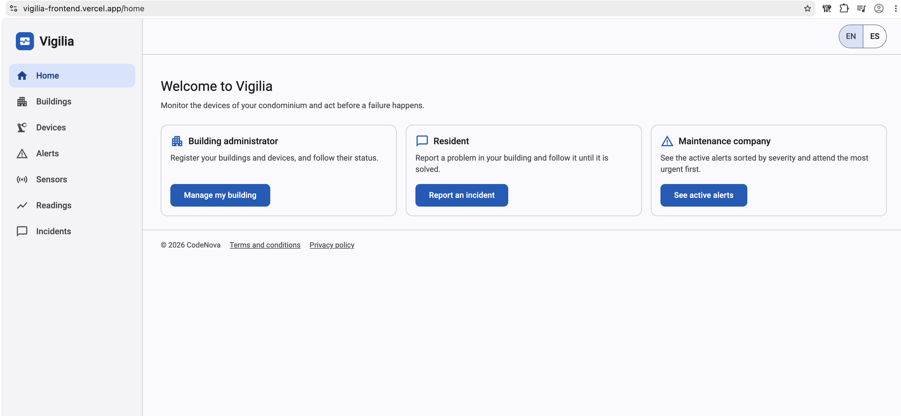

En Edificios el administrador registra, edita y elimina sus edificios (US07). Eliminar un edificio pide confirmación, porque no se puede deshacer.

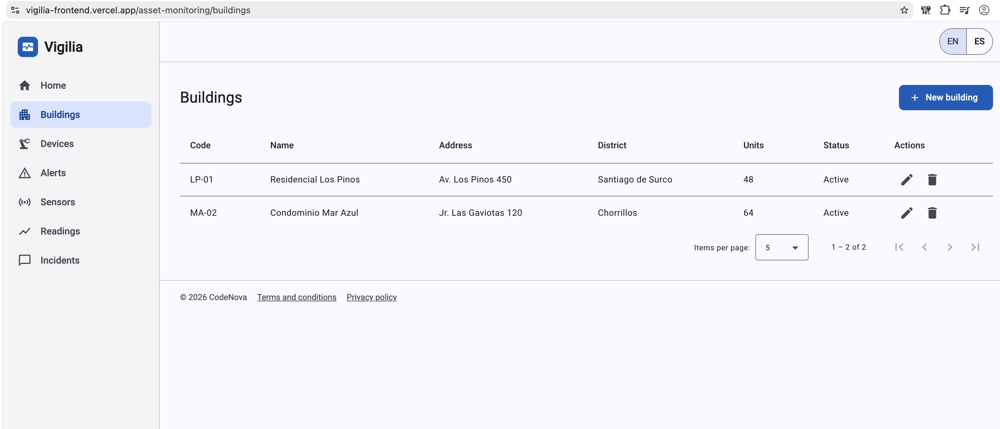

En Dispositivos registra los equipos críticos de cada edificio, los filtra por edificio y los da de baja (US08, US09 y US11). A pedido del profesor, en este sprint cambiamos el término *equipment* por *device* en todo el producto. Cada fila muestra además cuántas alertas activas tiene el dispositivo, para que su estado no se lea por separado.

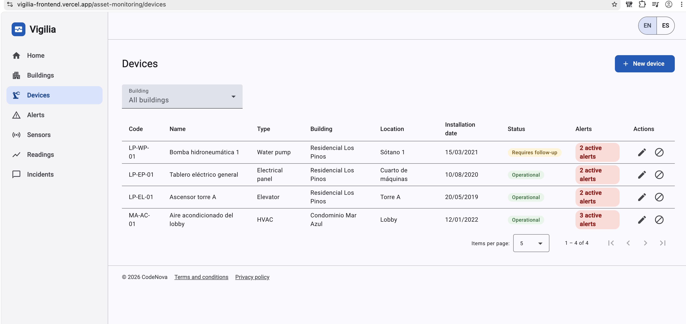

En Sensores se ve cada sensor, el dispositivo al que está asignado y su última señal. Asignar y liberar un sensor llama a los sub-recursos `assignments` y `releases` del API (US10).

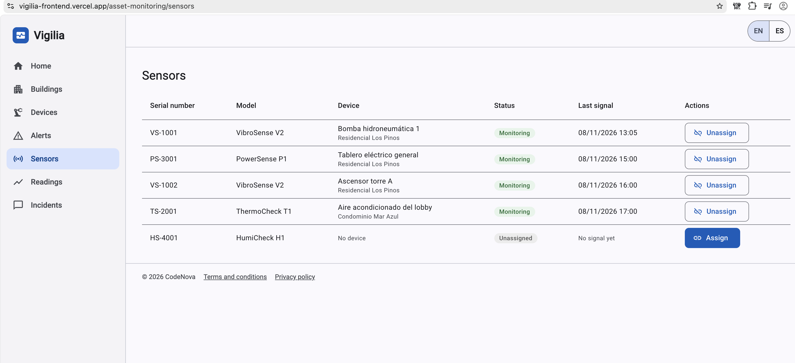

En Lecturas se consulta el historial de un dispositivo, de la más reciente a la más antigua (US14). Además de vibración, temperatura, humedad y consumo, ahora hay corriente y presión, que pidió la empresa de mantenimiento en la validación.

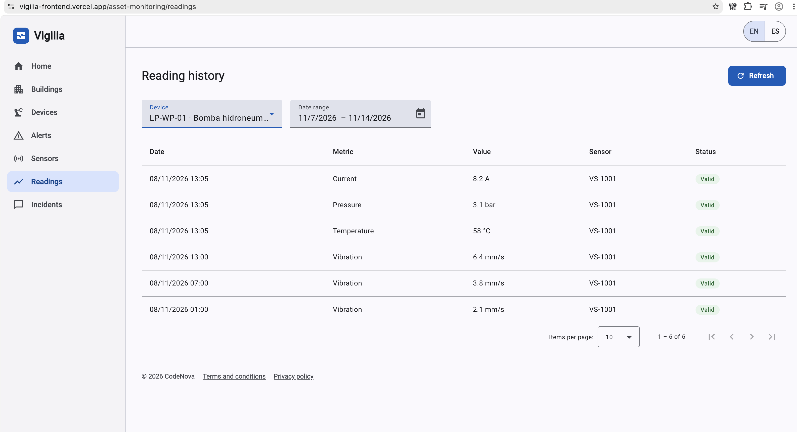

En Alertas la empresa de mantenimiento ve las alertas ordenadas por severidad, con un contador por nivel (US19 y US20). Cada alerta muestra su valor límite debajo del último valor. Entre alertas de la misma severidad va primero la que más supera su límite. El botón "Attend" ("Atender" en español) pone la alerta en gestión y "Resolve" pide confirmación. Arriba de la tabla hay filtros por edificio y por tipo de dispositivo.

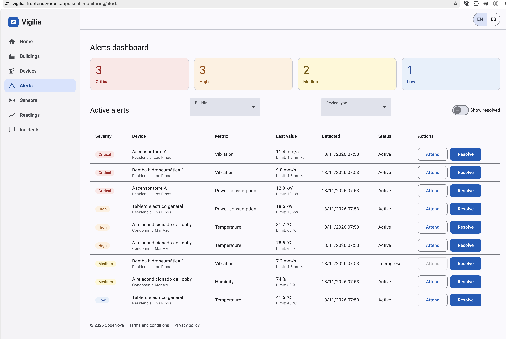

El residente reporta un incidente con su edificio, la categoría y una descripción (US23).

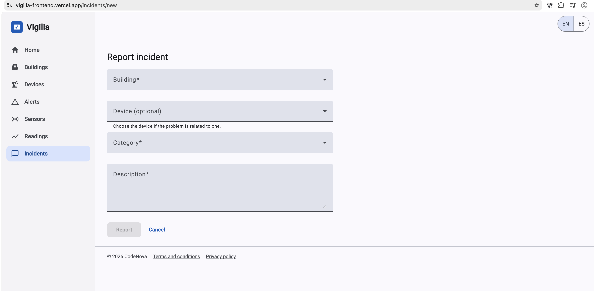

En Incidentes se sigue el estado de cada incidente: recibido, en gestión o resuelto (US25). La lista muestra el edificio de cada incidente y se puede filtrar por edificio.

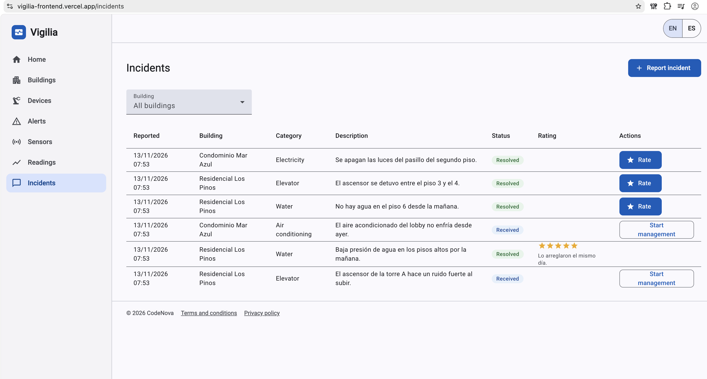

Cuando el incidente está resuelto, el residente lo califica de 1 a 5 y puede dejar un comentario (US27).

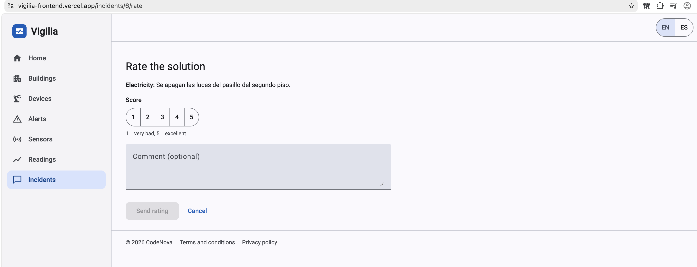

Si el API rechaza una acción, el formulario muestra el mensaje del `ProblemDetail`, en inglés o en español según el idioma elegido. Por ejemplo, al registrar un dispositivo con un código que ya existe en el edificio.

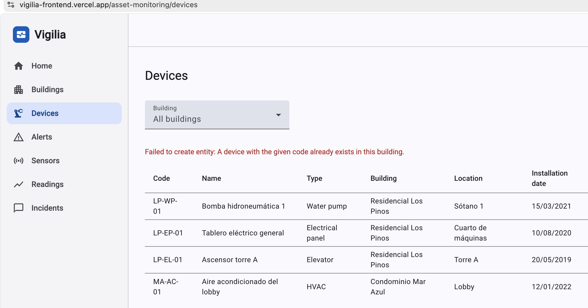

El pie de página de la aplicación enlaza los términos y condiciones y la política de privacidad. La primera vez que alguien abre la aplicación aparece un aviso de privacidad.

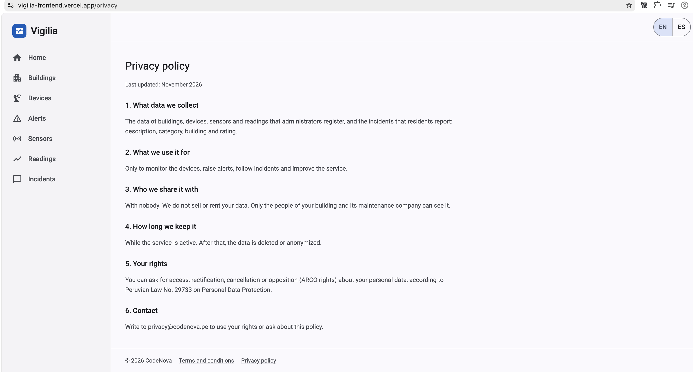

El video de navegación recorre el Landing Page y los flujos principales de la Web Application: registrar un edificio y un dispositivo, atender una alerta, y reportar, seguir y calificar un incidente.

- **Nombre del archivo:** upc-pre-202620-1asi0729-16692-CodeNova-productnavigation-sprint-3.mp4
- **URL del video:** <URL de Stream: navegación del producto>

#### 5.2.3.6. Services Documentation Evidence for Sprint Review

<!-- por completar -->

#### 5.2.3.7. Software Deployment Evidence for Sprint Review

En este sprint desplegamos la base de datos y el RESTful API, conectamos a ellos la Web Application ya publicada en Vercel y publicamos una nueva versión del Landing Page. Todos los productos se despliegan desde la rama `main` de su repositorio. A pedido del profesor, durante el sprint renombramos los repositorios: `backend` pasó a llamarse `Web-services`, `Frontend` pasó a `Web-App` y `landing-page` pasó a `Website`. Render, Vercel y GitHub Pages siguieron conectados después del cambio. El RESTful API salió con las versiones `0.1.0`, `0.2.0`, `0.3.0` y `2.0.0`, la Web Application con `0.2.0`, `0.3.0` y `2.0.0`, y el Landing Page con `0.2.0`, `0.3.0`, `0.3.1` y `0.3.2`.

**Base de datos en TiDB Cloud.**

1. Crear una cuenta en TiDB Cloud y un cluster del plan gratuito *Starter*.
2. En *Connect*, generar la contraseña y copiar el host, el puerto (4000) y el usuario, que lleva un prefijo propio del cluster.
3. En el *SQL Editor*, crear la base de datos con `CREATE DATABASE vigilia;`.

Hibernate crea las tablas al iniciar el RESTful API.

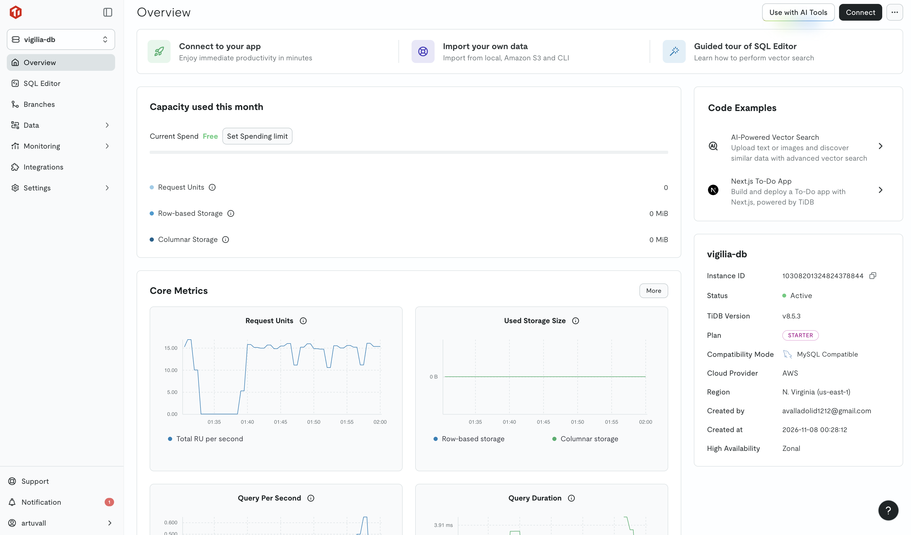

**RESTful API en Render.**

1. Crear un *Web Service* conectado al repositorio `Web-services` (antes `backend`), con la rama `main` y el runtime *Docker*. Render construye la imagen con el `Dockerfile` del repositorio.
2. Elegir el plan gratuito.
3. Agregar las variables de entorno: `SPRING_PROFILES_ACTIVE=prod`, `DATABASE_URL`, `DATABASE_PORT`, `DATABASE_NAME`, `DATABASE_USER`, `DATABASE_PASSWORD` y `JAVA_TOOL_OPTIONS=-XX:MaxRAMPercentage=75.0`, que limita la memoria de Java al plan gratuito.
4. Desplegar y revisar en los logs que el perfil activo sea `prod` y que la aplicación haya iniciado.
5. Abrir la documentación del API en Swagger UI.
6. Cargar los datos de demostración con `http/demo-data.http` desde IntelliJ IDEA, eligiendo el entorno `prod`. El archivo registra dos edificios, cuatro dispositivos, cuatro alertas y tres incidentes, y toma los ids de cada respuesta. Con la versión `0.2.0` también cargamos `http/demo-data-sensors.http`, que registra cinco sensores y sus lecturas.
7. Con la versión `0.3.0` cambiaron los nombres de tablas y columnas (`devices` y `device_id`). `ddl-auto=update` crea las tablas nuevas pero no mueve los datos, así que reiniciamos la base en el *SQL Editor* de TiDB (`DROP DATABASE vigilia; CREATE DATABASE vigilia;`), reiniciamos el servicio en Render para que Hibernate cree las tablas y volvimos a cargar los datos de demostración y los de las entrevistas.

Como en el Sprint 2, el plan gratuito apaga el servicio cuando no recibe tráfico, y la primera solicitud después de un rato tarda cerca de un minuto en responder.

URL del RESTful API: <https://vigilia-api.onrender.com/swagger-ui/index.html>

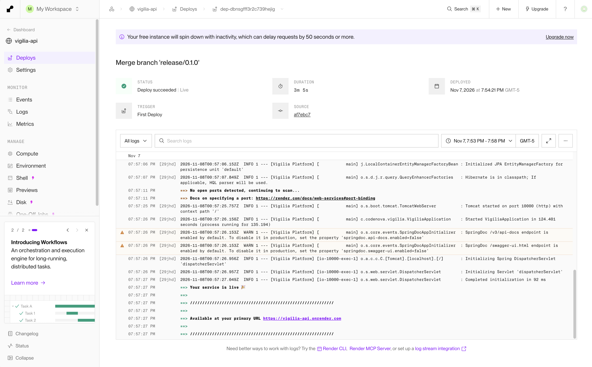

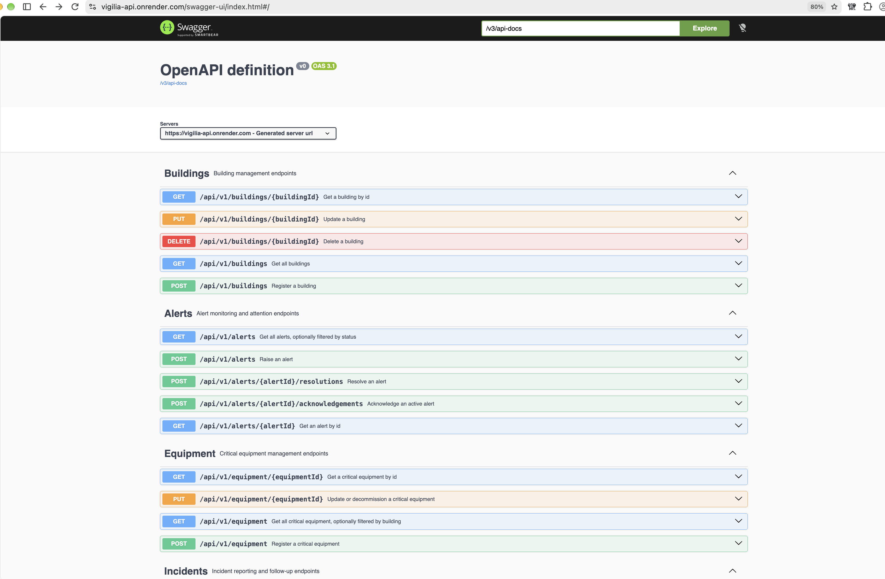

**Web Application en Vercel.**

1. Cambiar `src/environments/environment.ts` para que apunte a `https://vigilia-api.onrender.com/api/v1`.
2. Publicar la versión `0.2.0` con un release de GitFlow: merge de `release/0.2.0` a `main` con su tag.
3. Vercel detecta el cambio en `main` y publica la nueva versión. No cambiamos la configuración del Sprint 2.
4. Probar la aplicación con los datos de demostración: edificios, equipos críticos, reconocimiento y resolución de alertas, e incidentes.

El RESTful API solo acepta solicitudes desde `http://localhost:4200` y desde `https://vigilia-frontend.vercel.app` (CORS). Las versiones siguientes siguieron el mismo camino: con el merge a `main`, Render y Vercel publicaron la nueva versión sin cambiar su configuración. La versión `2.0.0` del RESTful API y de la Web Application es la que entregamos en AV2. Las dos salieron juntas porque el cambio a `/api/v1/devices` y `deviceId` cambió el contrato JSON.

URL de la Web Application: <https://vigilia-frontend.vercel.app/>

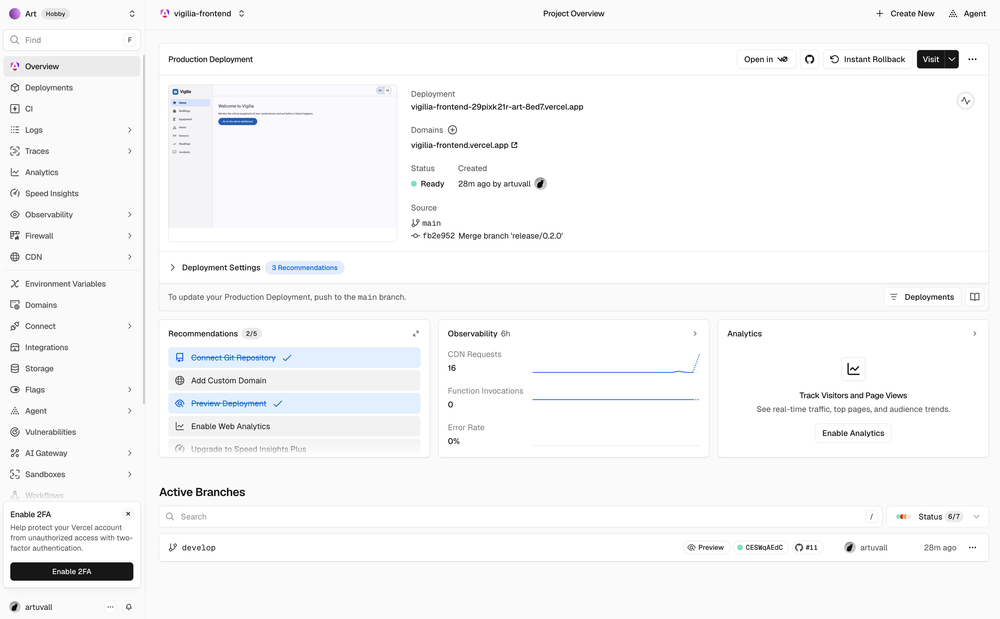

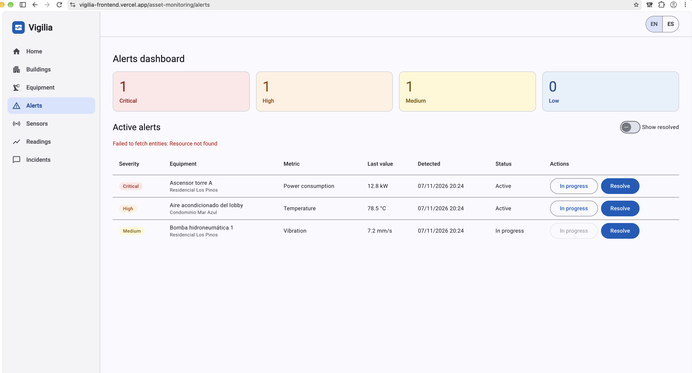

**Landing Page en GitHub Pages.**

1. Hacer el merge de `release/0.3.2` a `main` y crear el tag `0.3.2`.
2. GitHub Pages publica de nuevo el sitio desde `main`. Con el nombre nuevo del repositorio, la URL pasó a ser `/Website/`. Desde la versión `0.3.2` los archivos del sitio están en la carpeta `public/`, y el `index.html` de la raíz redirige ahí.
3. Revisar el sitio publicado: la sección con un botón por segmento justo debajo del hero, los términos y condiciones en su propia página, la política de privacidad, el libro de reclamaciones y los recuadros de video de About the Product y About the Team.

URL del Landing Page: <https://code-nova-1asi0729.github.io/Website/>

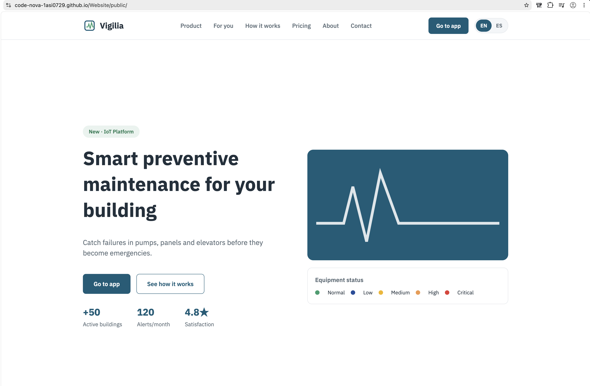

#### 5.2.3.8. Team Collaboration Insights during Sprint

Este sprint fue el primero con cuatro repositorios activos y con tres integrantes. Para no repetir lo que el profesor observó en TB1, repartimos el RESTful API por aggregate: Arturo hizo edificios, alertas, incidentes y el despliegue; Fernanda, los dispositivos; y Matthias, los sensores y las lecturas. Arturo armó primero el shared kernel y el aggregate de edificios como ejemplo, y los demás siguieron el mismo orden de clases.

En la segunda mitad del sprint el trabajo se repartió en los tres repositorios de código. Fernanda renombró Equipment a Device en el RESTful API y en la Web Application, agregó el valor límite de las alertas, las alertas activas por dispositivo y los términos y la política de privacidad. Matthias cambió las referencias a `deviceId` en sensores, lecturas e incidentes, conectó la asignación de sensores al API, agregó los filtros y las confirmaciones, el libro de reclamaciones del Landing Page y publicó el release `0.3.0` del RESTful API.

Tuvimos dos problemas que nos dejaron lecciones. El primero fue separar el dominio de la persistencia a mitad del sprint: edificios e incidentes pasaron a persistence entities con el patrón adapter, y los demás aggregates se construyeron así desde el inicio. El segundo fue que algunos Pull Requests se abrieron contra `main` en vez de `develop`, porque `main` es la rama por defecto en GitHub. Lo corregimos llevando esos cambios de vuelta a `develop` y reiniciando la base de datos de producción. Desde entonces revisamos la rama base de cada Pull Request antes de abrirlo.

Todavía debemos repartir mejor los commits a lo largo del sprint: buena parte del trabajo se concentró en las últimas dos semanas. Las capturas muestran Insights > Contributors de cada repositorio al cierre del sprint.

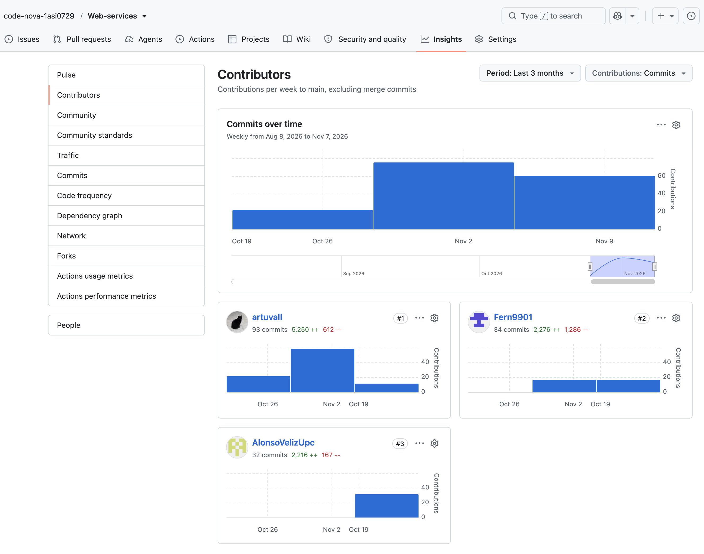

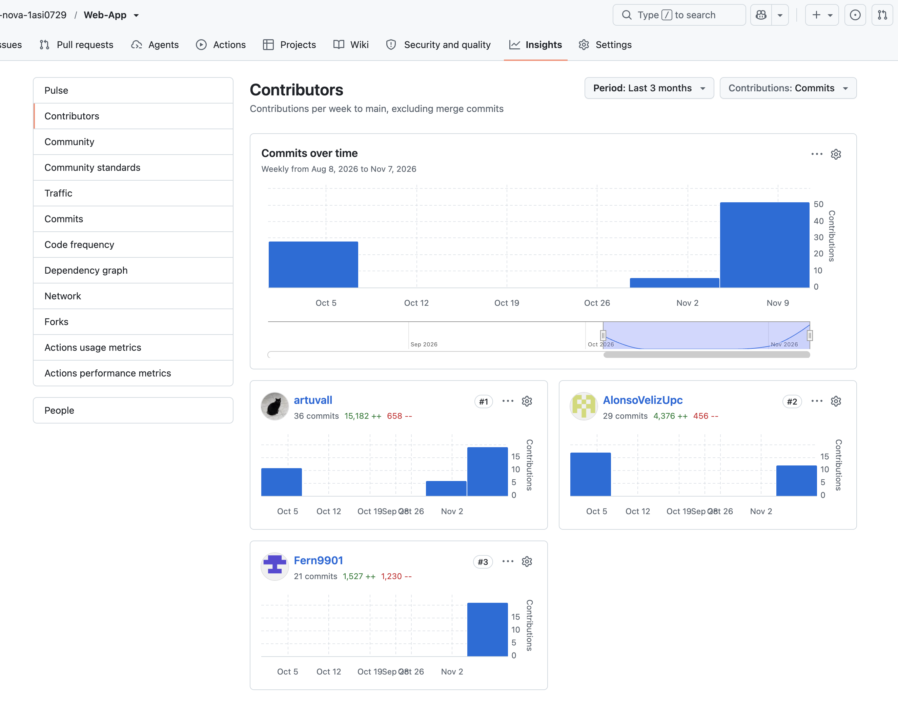

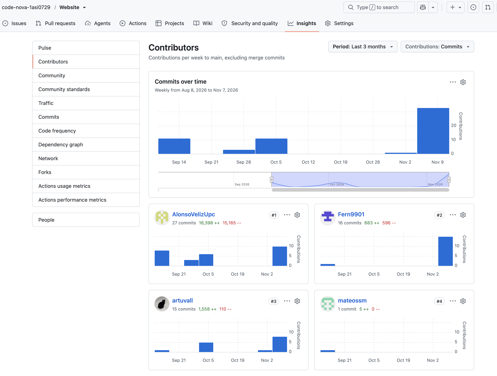

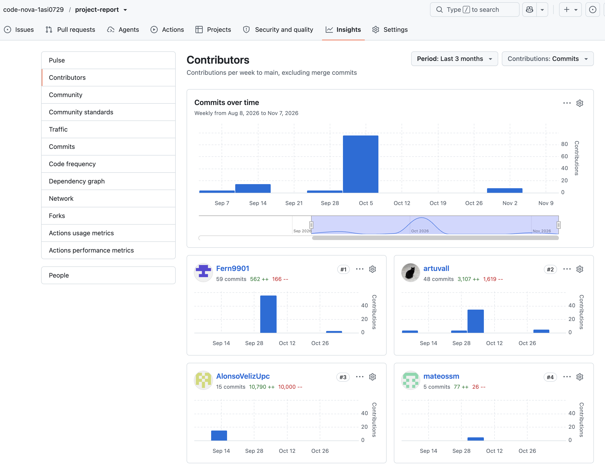
