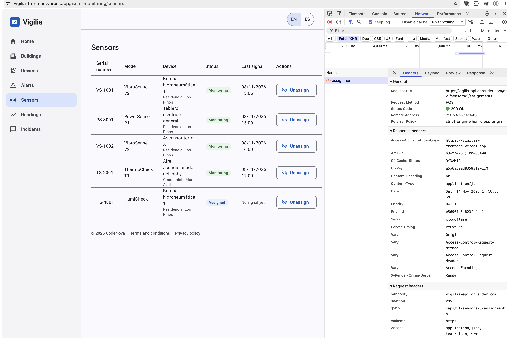
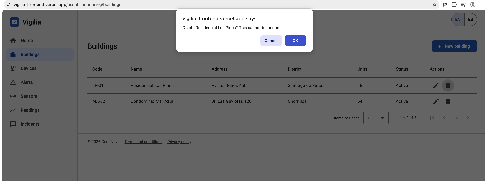
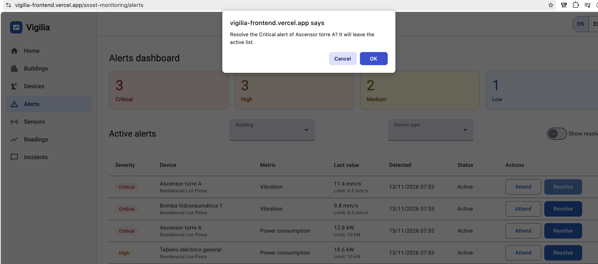
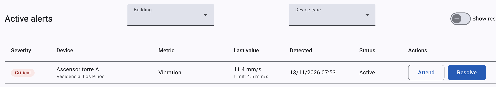
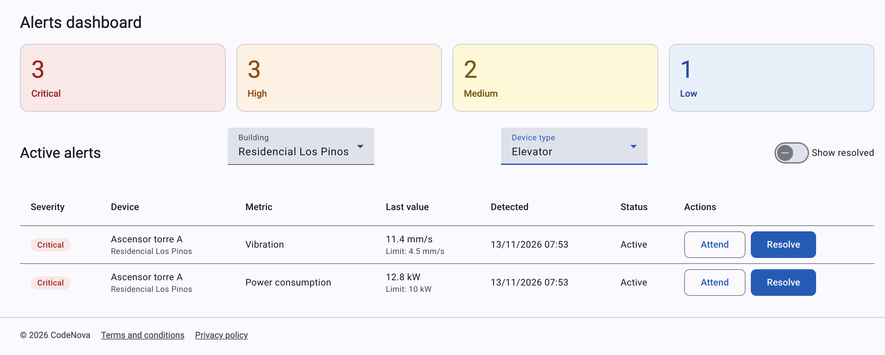
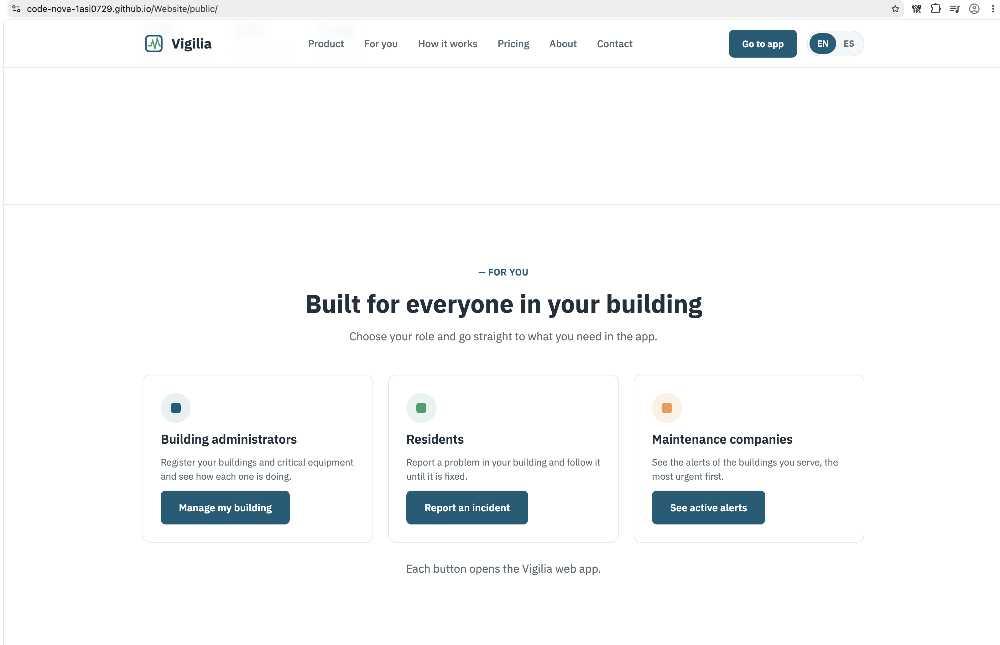

### 5.3.3. Evaluaciones según heurísticas

**UX Heuristics & Principles Evaluation**
**Usability – Inclusive Design – Information Architecture**

| | |
|:---|:---|
| **CARRERA** | Ingeniería de Software |
| **CURSO** | Desarrollo de Aplicaciones Open Source |
| **SECCIÓN** | 16692 |
| **PROFESORES** | Todos |
| **AUDITOR** | CodeNova |
| **CLIENTE(S)** | Entrevistados de los tres segmentos |

**SITE o APP A EVALUAR:** Vigilia (Landing Page y Web Application).

**TAREAS A EVALUAR:**

El alcance de esta evaluación incluye la revisión de la usabilidad de las siguientes tareas:

1. Registrar un edificio.
2. Registrar un dispositivo.
3. Asignar un sensor a un dispositivo.
4. Consultar el historial de lecturas de un dispositivo.
5. Ver las alertas activas, atenderlas y resolverlas.
6. Reportar un incidente.
7. Seguir el estado de un incidente y calificarlo.
8. Ir desde el Landing Page a la vista de cada segmento.

No están incluidas en esta versión de la evaluación las siguientes tareas:

1. Iniciar sesión y registrarse (IAM, Sprint 4).
2. Programar y registrar visitas de mantenimiento (Sprint 4).
3. Recibir notificaciones (Sprint 4).
4. Recibir alertas generadas a partir de las lecturas de los sensores.

**ESCALA DE SEVERIDAD:** Los errores se puntúan con la siguiente escala de severidad.

| Nivel | Descripción |
|:---:|:---|
| 1 | Problema superficial: el usuario lo supera fácilmente o ocurre muy poco. No necesita arreglarse a menos que sobre tiempo. |
| 2 | Problema menor: ocurre un poco más seguido o es un poco más difícil de superar. Se resuelve con prioridad baja en el siguiente release. |
| 3 | Problema mayor: ocurre seguido o el usuario no lo puede resolver. Debe corregirse con prioridad alta. |
| 4 | Problema muy grave: impide al usuario seguir usando la herramienta. Es imperativo corregirlo antes del lanzamiento. |

**TABLA RESUMEN:**

Evaluamos la versión `0.3.0` de la Web Application y la versión `0.2.0` del Landing Page, que eran las publicadas durante las entrevistas. La última columna indica si el problema quedó corregido en las versiones que entregamos en AV2 (Web Application `2.0.0` y Landing Page `0.3.2`). Las capturas de los problemas corregidos muestran la solución.

| # | Problema | Escala de severidad | Heurística/Principio violada(o) | Estado en AV2 |
|:---:|:---|:---:|:---|:---|
| 1 | Asignar o liberar un sensor no funciona | 4 | Usability: Ayudar a reconocer, diagnosticar y recuperarse de errores | Corregido |
| 2 | Un edificio se elimina sin pedir confirmación | 3 | Usability: Prevención de errores | Corregido |
| 3 | Resolver una alerta o un incidente no se puede deshacer | 3 | Usability: Libertad y control del usuario | Corregido |
| 4 | El botón para reconocer una alerta dice "In progress" | 2 | Usability: Coincidencia entre el sistema y el mundo real | Corregido |
| 5 | La lista de incidentes no dice a qué edificio pertenece cada uno | 2 | Information Architecture: Is it findable? | Corregido |
| 6 | Home no muestra el estado general del monitoreo | 2 | Usability: Visibilidad del estado del sistema | Pendiente |
| 7 | El estado de un dispositivo no refleja sus alertas activas | 3 | Usability: Visibilidad del estado del sistema | Corregido |
| 8 | Las alertas no muestran un valor de referencia | 2 | Usability: Reconocer antes que recordar | Corregido |
| 9 | No se pueden filtrar las alertas por edificio ni por tipo | 2 | Usability: Flexibilidad y eficiencia de uso | Corregido |
| 10 | La sección por segmento está lejos del inicio del Landing Page | 1 | Information Architecture: Is it findable? | Corregido |
| 11 | El Landing Page se abre en inglés | 1 | Inclusive Design: Ofrecer una experiencia comparable | Pendiente |

**DESCRIPCIÓN DE PROBLEMAS:**

**PROBLEMA #1: Asignar o liberar un sensor no funciona**

Severidad: 4

Heurística violada: Usability – Ayudar a reconocer, diagnosticar y recuperarse de errores

Problema: en Sensores, los botones *Assign* y *Unassign* fallaban. La Web Application enviaba un `PUT` a `/sensors/{sensorId}`, pero el RESTful API cambió a los sub-recursos `assignments` y `releases`. El usuario no lograba asignar el sensor y no entendía por qué.

Recomendación: llamar a `POST /sensors/{sensorId}/assignments` y `POST /sensors/{sensorId}/releases` desde el store, como ya se hace con las alertas.

Estado: corregido en la tarea T20. La captura muestra la llamada a `assignments` al asignar un sensor.

**PROBLEMA #2: Un edificio se elimina sin pedir confirmación**

Severidad: 3

Heurística violada: Usability – Prevención de errores

Problema: en Edificios, el ícono de eliminar borraba el edificio con un solo clic. Está junto al ícono de editar, así que era fácil equivocarse, y el edificio no se puede recuperar.

Recomendación: pedir confirmación con el nombre del edificio antes de eliminarlo, como ya se hacía al dar de baja un dispositivo.

Estado: corregido. Eliminar un edificio pide confirmación con su nombre y avisa que no se puede deshacer.

**PROBLEMA #3: Resolver una alerta o un incidente no se puede deshacer**

Severidad: 3

Heurística violada: Usability – Libertad y control del usuario

Problema: en Alertas e Incidentes, el botón *Resolve* cambiaba el estado de inmediato. La entrevistada de mantenimiento lo dijo así: si lo aprieta sin querer, se cierra una alerta crítica.

Recomendación: pedir confirmación antes de resolver, mostrando el dispositivo y la severidad, o el incidente.

Estado: corregido. Resolver una alerta o un incidente pide confirmación, y con *Cancelar* no cambia nada.

**PROBLEMA #4: El botón para reconocer una alerta dice "In progress"**

Severidad: 2

Heurística violada: Usability – Coincidencia entre el sistema y el mundo real

Problema: el botón que pone una alerta en gestión decía "In progress", que suena a un estado y no a una acción. La entrevistada dudó si la alerta ya estaba en gestión o si el botón la ponía en gestión.

Recomendación: usar un verbo en el botón, como "Atender", y dejar "En atención" solo como estado.

Estado: corregido. El botón dice "Attend" ("Atender" en español) y el estado se muestra como "In progress" ("En atención") (ver la Figura 5.2.3-L).

**PROBLEMA #5: La lista de incidentes no dice a qué edificio pertenece cada uno**

Severidad: 2

Heurística violada: Information Architecture – Is it findable?

Problema: la lista de Incidentes mostraba la fecha, la categoría, la descripción y el estado, pero no el edificio. Si el administrador tiene varios edificios, no sabía de dónde venía cada reporte.

Recomendación: agregar la columna del edificio y un filtro por edificio, como en la lista de dispositivos.

Estado: corregido. La lista muestra el edificio y tiene un filtro por edificio (ver la Figura 5.2.3-N).

**PROBLEMA #6: Home no muestra el estado general del monitoreo**

Severidad: 2

Heurística violada: Usability – Visibilidad del estado del sistema

Problema: Home tiene tres accesos por segmento, pero no dice si hay algo urgente. El administrador tiene que entrar a Alertas e Incidentes para saber si hay alertas críticas o incidentes abiertos.

Recomendación: agregar en Home un resumen con las alertas activas por severidad y los incidentes abiertos, con un enlace a cada vista.

Estado: pendiente para el Sprint 4.

**PROBLEMA #7: El estado de un dispositivo no refleja sus alertas activas**

Severidad: 3

Heurística violada: Usability – Visibilidad del estado del sistema

Problema: en la lista de equipos, el ascensor de Residencial Los Pinos decía *Operational* aunque tenía dos alertas críticas en el tablero. La entrevistada dijo que no sabía si fiarse de ese estado.

Recomendación: mostrar en cada dispositivo cuántas alertas activas tiene, con un enlace al tablero de alertas.

Estado: corregido. La lista de dispositivos tiene una columna con las alertas activas, resaltadas en rojo (ver la Figura 5.2.3-I).

**PROBLEMA #8: Las alertas no muestran un valor de referencia**

Severidad: 2

Heurística violada: Usability – Reconocer antes que recordar

Problema: la alerta de la bomba mostraba una vibración de 9.8 mm/s, pero la entrevistada no sabía si ese valor era mucho o poco. Entre tres alertas críticas tampoco sabía por cuál empezar.

Recomendación: guardar en cada alerta el valor límite de su métrica, mostrarlo junto al último valor y usarlo para ordenar las alertas de la misma severidad.

Estado: corregido. Cada alerta muestra su límite, y entre alertas de la misma severidad va primero la que más lo supera.

**PROBLEMA #9: No se pueden filtrar las alertas por edificio ni por tipo**

Severidad: 2

Heurística violada: Usability – Flexibilidad y eficiencia de uso

Problema: el tablero de alertas solo tenía el interruptor para mostrar las resueltas. La empresa de mantenimiento arma la ruta de sus técnicos por edificio y por tipo de equipo, y no podía hacerlo desde la aplicación.

Recomendación: agregar filtros por edificio y por tipo de dispositivo, sin cambiar los contadores por severidad.

Estado: corregido.

**PROBLEMA #10: La sección por segmento está lejos del inicio del Landing Page**

Severidad: 1

Heurística violada: Information Architecture – Is it findable?

Problema: la sección con un botón por segmento estaba después de las funciones y del "cómo funciona". La entrevistada quería entrar directo a su parte y que quedara claro que el botón abre la aplicación.

Recomendación: subir la sección debajo del hero, enlazarla desde el menú y avisar que cada botón abre la Web Application.

Estado: corregido en el Landing Page `0.3.1`.

**PROBLEMA #11: El Landing Page se abre en inglés**

Severidad: 1

Heurística violada: Inclusive Design – Ofrecer una experiencia comparable

Problema: el Landing Page se abre en inglés y el visitante tiene que cambiar el idioma. La entrevistada lo notó apenas entró, aunque entendió el producto.

Recomendación: abrir el sitio en español cuando el idioma del navegador sea español y recordar la elección del visitante.

Estado: pendiente para el Sprint 4.
