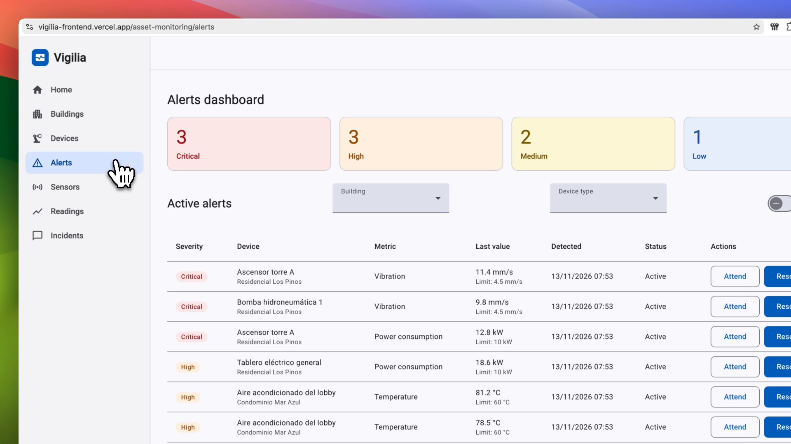

## 5.4. Video About-the-Product

El video presenta Vigilia en menos de dos minutos. Empieza con el problema: en la mayoría de edificios, la bomba de agua, el ascensor o el tablero eléctrico se revisan recién cuando fallan, y para entonces la reparación cuesta más, tarda más y deja a los residentes sin servicio. Luego muestra la solución: sensores en los dispositivos críticos que avisan cuando una lectura sale de su rango, pensada para administradores, residentes y empresas de mantenimiento. Recorre la Web Application desplegada: los edificios con alertas activas, el historial de lecturas de cada dispositivo, el tablero de alertas ordenadas por severidad con su valor límite, la empresa de mantenimiento cerrando una alerta y el residente que reporta, sigue y califica un incidente. Cierra con el modelo de negocio, una cuota fija mensual por edificio, y los planes del Landing Page.

- **Nombre del archivo:** upc-pre-202620-1asi0729-16692-CodeNova-about-the-product-sprint-3.mp4
- **URL del video:** <https://upcedupe-my.sharepoint.com/:v:/g/personal/u202420147_upc_edu_pe/IQDrk6pAhEe4QKFRebxBQf-rARomxK1JIq9P3oUh1vmmoMk?nav=eyJyZWZlcnJhbEluZm8iOnsicmVmZXJyYWxBcHAiOiJPbmVEcml2ZUZvckJ1c2luZXNzIiwicmVmZXJyYWxBcHBQbGF0Zm9ybSI6IldlYiIsInJlZmVycmFsTW9kZSI6InZpZXciLCJyZWZlcnJhbFZpZXciOiJNeUZpbGVzTGlua0NvcHkifX0&e=qBFXiE>
- **Video incrustado en el Landing Page:** <https://youtu.be/NyvKj3HQd98>
- **Duración:** 01:39
