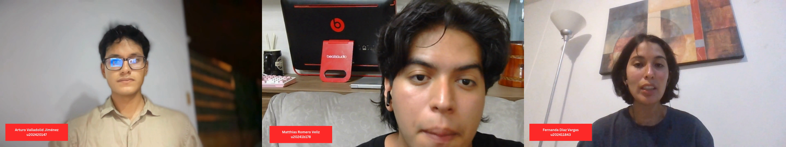

<!-- latex:
\newpage
-->

# 6. Conclusiones

- La mayoría de edificios de Lima hace mantenimiento reactivo: se llama al técnico cuando la bomba ya se quemó o el ascensor ya se detuvo. Las entrevistas lo confirmaron en los tres segmentos. Nadie tiene datos del estado de los equipos antes de la falla.
- El problema que planteamos en el Lean UX Process se sostiene. Las administradoras entrevistadas no tienen cómo mostrar a la junta lo que se ahorró por prevenir, y las empresas de mantenimiento priorizan por orden de llegada y no por gravedad.
- Los residentes no quieren datos técnicos. Les basta un canal claro para reportar y ver el estado de su reporte. Por eso el reporte de incidentes es simple y muestra solo tres estados.
- Ordenar el backlog por valor de negocio nos ayudó a enfocarnos. En el Sprint 2 construimos primero lo que el administrador usa cada día (edificios, equipos, sensores, lecturas y alertas) y el reporte de incidentes del residente. IAM quedó para el final, porque no diferencia a Vigilia.
- Usar los mismos cinco bounded contexts en el diseño, en el frontend y en el backend hizo que el informe y el código usen los mismos nombres. Cada carpeta del frontend corresponde a un contexto del capítulo IV.
- Trabajar con un fake API con los mismos endpoints que tendrá el RESTful API nos permitió terminar la Web Application sin esperar al backend. En el Sprint 3 solo cambia la URL base.
- Pasar el informe a Markdown y usar GitFlow en todos los repositorios ordenó el trabajo del equipo. Ahora cada cambio tiene un autor, una rama y un Pull Request.
- En el Sprint 3 el RESTful API reemplazó al fake API sin cambiar las vistas: solo cambió la URL base. Nos sirvió mantener el mismo formato JSON desde el Sprint 2.
- Separar el aggregate de su persistence entity nos costó un cambio a mitad del sprint, pero dejó el dominio sin dependencias de JPA y más fácil de probar.
- Nombrar los comandos con el lenguaje ubicuo (`RegisterBuilding`, `AcknowledgeAlert`, `RateIncident`) y exponerlos como sub-recursos con POST hizo que las reglas del negocio se vean en el API.
- Las entrevistas de validación sobre la aplicación desplegada nos dieron cambios concretos. La empresa de mantenimiento nos llevó a agregar el valor límite en cada alerta, el botón "Atender", las confirmaciones antes de eliminar o resolver, los filtros por edificio y tipo de dispositivo, y las métricas de corriente y presión. Casi todos entraron en la versión `2.0.0`. El propietario confirmó que reportar un incidente es simple, pero pidió saber quién lo atiende y recibir un aviso cuando cambie su estado.
- Cambiar *equipment* por *device* tocó el dominio, el API, la base de datos, la Web Application y el informe a la vez. Hacerlo con las herramientas de renombrar del IDE, una capa por commit, evitó errores, pero nos obligó a reiniciar la base de datos de producción.

## Video About-the-Team

En el Sprint 3 construimos la primera versión del RESTful API, la desplegamos en Render con la base de datos en TiDB Cloud y conectamos la Web Application a ella. Cada integrante tuvo a su cargo una parte del API y grabó su testimonio. En la primera parte del video, el Team Leader presenta el equipo y el producto, y hace la retrospectiva del sprint: qué construimos, cómo nos repartimos el trabajo, qué salió bien, qué debemos mejorar y nuestros compromisos para el Sprint 4. Después, Matthias y Fernanda cuentan lo que hizo cada uno en el Landing Page, la Web Application y el RESTful API.

| Inicio (hh:mm:ss) | Sección |
|:---:|:---|
| 00:00:00 | Presentación del equipo y del producto, a cargo de Valladolid Jiménez, Arturo Fernando |
| 00:00:40 | Retrospectiva del Sprint 3: qué hicimos, cómo nos organizamos, qué salió bien y qué mejorar |
| 00:02:24 | Compromisos para el Sprint 4 |
| 00:02:39 | Testimonio de Romero Veliz, Matthias Alonso |
| 00:04:37 | Testimonio de Diaz Vargas, Fernanda Ysabella |

- **Nombre del archivo:** upc-pre-202620-1asi0729-16692-CodeNova-about-the-team-sprint-3.mp4
- **URL del video:** <https://upcedupe-my.sharepoint.com/:v:/g/personal/u202420147_upc_edu_pe/IQDWvHiriRWVQII1MAFmEnSGAfXd_Ip2sr-8vPlxCWbAEbA?nav=eyJyZWZlcnJhbEluZm8iOnsicmVmZXJyYWxBcHAiOiJPbmVEcml2ZUZvckJ1c2luZXNzIiwicmVmZXJyYWxBcHBQbGF0Zm9ybSI6IldlYiIsInJlZmVycmFsTW9kZSI6InZpZXciLCJyZWZlcnJhbFZpZXciOiJNeUZpbGVzTGlua0NvcHkifX0&e=iadS2l>
- **Duración:** 06:45

# 7. Recomendaciones

- Resolver los tres problemas pendientes de la evaluación heurística (5.3.3): un resumen del monitoreo en Home, abrir el Landing Page en el idioma del navegador y mostrar quién atiende cada incidente y cuándo se espera resolverlo.
- Construir en el Sprint 4 lo que pidieron las empresas de mantenimiento: el detalle de la resolución, el reporte en PDF para la junta y los avisos por correo o WhatsApp (US51 a US53).
- Revisar la rama base de cada Pull Request antes de abrirlo, para que ningún cambio llegue a `main` sin un release.
- Muchos cuartos de bombas y tableros están en sótanos con mala señal. Los sensores deberían guardar las lecturas y enviarlas cuando recuperen la conexión, para no perder datos.
- En el Sprint 4, generar las alertas a partir de las lecturas con un domain event, y agregar Maintenance, Notifications e IAM.
- Empezar cada sprint con commits desde la primera semana, para que el trabajo no se concentre al final.
- Mostrar mensajes simples en las alertas y reportes. Por ejemplo, "La bomba de agua tiene vibraciones fuera de lo normal; se recomienda una revisión preventiva" en lugar de lecturas técnicas.
- Antes de sumar más edificios, hacer pruebas de seguridad, rendimiento y usabilidad.
